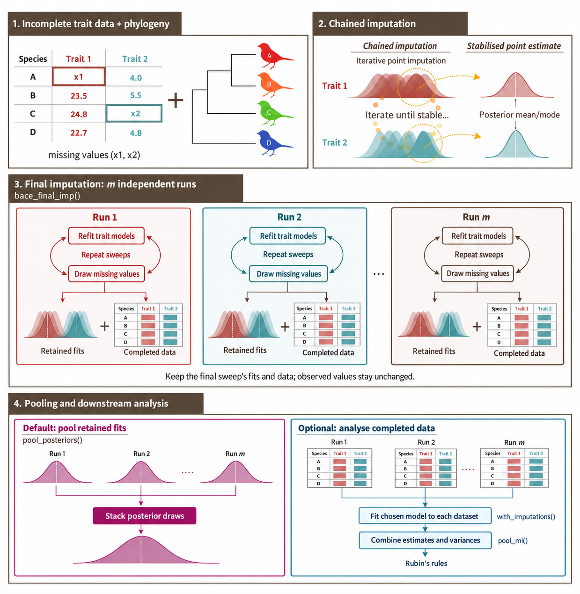

# Abstract

1. Missing trait data are pervasive in comparative datasets limiting the types of questions that can be tested and compromising the power of comparative analyses. Standard approaches, such as complete-case analyses and single imputation, can bias inference and underestimate uncertainty, particularly when missing data is non-random. While robust imputation methods exits, many impute only one complete dataset and are restricted to imputing only continuous or count variables – lacking the capacity to impute discrete / categorical traits (e.g., multinomial, ordered categorical), which are common trait types in comparative datasets. Such limitations have prevented the widespread use of imputation approaches in comparative biology.
2. We introduce **B**ayesian **A**ugmentation by **C**hained **E**quations (**BACE**) as a way to impute missing traits for phylogenetic comparative data. *BACE* enables imputation with phylogeny-informed covariance that can account for both phylogenetic and non-phylogenetic species effects, along with mixed data types. *BACE* provides substantial flexibility in the imputation models fit, can decouple imputation models from analysis models, and propagates both parameter and imputation uncertainty in subsequent downstream analyses. To facilitate its uptake we provide the *BACE* R package, available for download on CRAN, along with a detailed tutorial on how it can be used.
3. Using simulations, we show that *BACE* provides little bias and nominal coverage in analyses with even a small number of species (~100) for diverse trait types, and those with small to moderate phylogenetic signal. We illustrate the use of *BACE* using two case studies: 1) imputing missing heat tolerance data across 5,203 species of amphibians from 524 species with data (89.9% missing data) and 2) jointly imputing an bird social-grouping and wing shape across 10,563 bird species, where social behaviour was missing for 40% of species. 
4. *BACE* provides a flexible, accessible workflow for imputing diverse trait types in comparative datasets. We show with our case studies and simulations that it can provide powerful ways to recover missing trait data when phylogenetic signal and trait covariance is high. Although computationally demanding, it makes multiple imputation more widely applicable, supporting broader evolutionary questions and informing vulnerability assessments and conservation policy while accounting for missing-data uncertainty. 

# Introduction

Phylogenetic comparative methods (PCMs) provide a framework for understanding how traits evolve and covary across species [@felsenstein1985; @grafen1989; @pagel1994; @martins1997]. Expanding trait databases, increasingly comprehensive phylogenies, and greater access to environmental data are providing opportunities to investigate how evolutionary history and environmental conditions jointly shape (co)variation among traits allowing a rich set of new evolutionary hypotheses to be tested [@halliwell2025; @blomberg2025]. Phylogenetic information can also be used to support vulnerability assessments of poorly known species [@pottier2025; @james2021] and predict extinction risk to inform conservation priorities and policy [@gonzalezdelpliego2019; @dinnage2020; @cardillo2023]. However, missing trait data limit these endeavors, and excluding species with incomplete records can reduce sample sizes, statistical power and precision in comparative analyses [@nakagawa2008; @little2024; @blomberg2025]. When the availability of trait data depends on species' characteristics, this exclusion can also bias estimates of trait relationships with significant consequences for inferences [@nakagawa2008; @gonzalezsuarez2012; @garamszegi2011]. For example, incomplete trait coverage has been shown to alter inferred relationships between mammalian traits and extinction risk [@gonzalezsuarez2012]. As such, there is a need for versatile and rigorous statistical approaches to deal with missing data in comparative biology.

Methods for handling missing data have a long history in statistics, and two broad approaches are commonly used [@noble2021; @blomberg2025; @littlerubin2002; @schafer2002; @rubin1987]. First, missing data can be accommodated during maximum-likelihood or Bayesian model fitting. For example, Bayesian data augmentation samples missing values alongside model parameters [@tanner1987]. Alternatively, multiple-imputation can be used to create, *m* completed datasets and each dataset analysed separately. Results are then pooled to account for within- and between-imputation uncertainty, using Rubin's rules for estimates and variances or combining posterior draws for Bayesian analyses [@rubin1987; @noble2021; @zhou2010]. These approaches are not mutually exclusive. Data augmentation can also generate the completed datasets used in multiple imputation. Imputations can be generated using a joint model for all variables or separate conditional models linked through chained equations. Chained equations cycle through models, drawing missing values for each variable using the latest values of the others. This approach, also called fully conditional specification, allows different models for continuous and categorical traits [@vanbuuren2011]. Standard multiple-imputation analyses assume data are missing at random (MAR), conditional on the variables included in the imputation models. As such, including traits associated with both the missing values and the probability of missingness helps make this assumption more plausible [@schafer2002; @gelmanhill2007, chap. 25; @noble2021]. In comparative biology, both phylogenetic prediction of missing trait values [@bruggeman2009; @goolsby2017] and multiple imputation [@pottier2025; @blomberg2025] have been used to deal with missing trait data. However, for widespread use in comparative biology, imputation models must accommodate diverse trait distributions and relationships which are often not possible with existing software.

While a broad array of statistical methods and packages exist to deal with missing data, many are not suited to the datasets typical of comparative biology (@tbl-software). A few packages can use the phylogeny in their imputation models (e.g., *Rphylopars*, *phylomice*, *TDIP*), but most cannot (e.g., *mice*, *miceadds*, *jomo*, *pan*; @tbl-software). Moreover, the phylogeny-aware packages generally return a single completed dataset or single predicted values rather than multiple imputations, and most impute only continuous traits. A notable exception is *TDIP* [@gendre2024], which combines phylogenetic and machine-learning methods in an ensemble and can impute discrete traits. However, it too returns single completed datasets, and it cannot handle multi-level data structures, count data, or ordered categorical traits (@tbl-software). As such, there is a need for a statistically robust and flexible imputation approach that can handle multi-level data structures and a diversity of trait types, while ensuring imputation uncertainty is correctly accounted for in any downstream analyses and interpretations.

Here, we introduce **B**ayesian **A**ugmentation by **C**hained **E**quations (**BACE**), along with an associated R package, which uses the versatile Bayesian software *MCMCglmm* [@hadfield2010jss] to conduct multiple imputation through chained equations. *BACE* provides substantial flexibility in the imputation / analysis models fit, as well as a simple user interface, which makes it easy to apply in practice. *BACE* also provides options to decouple imputation and analysis models. Given its Bayesian approach, imputation and analysis models can be fit jointly and a final analysis model allows for pooling of posterior distributions to account for within and across imputation uncertainty. Additionally, samples from the posterior predictive distribution can be used to generate a set of *m* complete datasets and these datasets can be used with any modelling approach and pooled using Rubin's rules. We describe how *BACE* works, test its robustness using simulations, and demonstrate how to apply it using two case studies.

<!-- authors: every cell of @tbl-software was verified against the package's own
reference documentation (current CRAN/GitHub version, October 2026); page-cited
evidence in .agents/software-comparison-evidence.md — intended as Supporting
Information at submission. -->

| Package | Phylo. | MI | Multi. | Cont. | Count | Bin. | Ord. | Nom. | Reference |
|:---|:---:|:---:|:---:|:---:|:---:|:---:|:---:|:---:|:---|
| **BACE** | **✓** | **✓** | (✓)^a^ | **✓** | **✓** | **✓** | **✓** | **✓** | this paper |
| Rphylopars | ✓ | ✗ | (✓) | ✓ | ✗ | ✗ | ✗ | ✗ | @goolsby2017 |
| phylomice^c^ | ✓ | ✓ | ✗ | ✓ | ✗ | ✗ | ✗ | ✗ | @drhlik2016 |
| TDIP^c^ | ✓ | ✗ | ✗ | ✓ | ✗ | ✓ | ✗ | ✓ | @gendre2024 |
| BHPMF^c^ | (✓)^b^ | ✗ | (✓) | ✓ | ✗ | ✗ | ✗ | ✗ | @schrodt2015 |
| mice | ✗ | ✓ | (✓) | ✓ | ✗ | ✓ | ✓ | ✓ | @vanbuuren2011 |
| miceadds | ✗ | ✓ | ✓ | ✓ | ✗ | ✓ | (✓)^d^ | ✗^d^ | @robitzsch2026 |
| micemd | ✗ | ✓ | ✓ | ✓ | ✓ | ✓ | (✓)^d^ | (✓)^d^ | @audigier2018 |
| pan | ✗ | ✓ | ✓ | ✓ | ✗ | ✗ | ✗ | ✗ | @schaferyucel2002 |
| jomo | ✗ | ✓ | ✓ | ✓ | ✗ | ✓ | (✓)^d^ | ✓ | @carpenter2013 |
| mitml | ✗ | ✓ | ✓ | ✓ | ✗ | ✓ | ✗ | ✓ | @grund2023 |
| hmi^c^ | ✗ | ✓ | ✓ | ✓ | ✓ | ✓ | ✓ | ✓ | @speidel2020 |
| mdmb | ✗ | ✓ | (✓) | ✓ | ✗ | ✓ | ✓ | ✗ | @robitzsch2024 |
| JointAI | ✗ | (✓)^e^ | ✓ | ✓ | ✓ | ✓ | ✓ | ✓ | @erler2021 |
| smcfcs | ✗ | ✓ | ✗ | ✓ | ✓ | ✓ | ✓ | ✓ | @bartlett2015 |
| missForest | ✗ | ✗ | ✗ | ✓ | ✗ | ✓ | ✗ | ✓ | @stekhoven2012 |

: R tools for imputing missing data, against the needs of phylogenetic comparative analysis. *Phylogeny* (Phylo.): a tree-derived covariance informs the imputation. *Proper multiple imputation* (MI): multiple imputed datasets (or an integrated Bayesian posterior) are produced, so downstream analyses reflect imputation uncertainty. *Multilevel* (Multi.): non-independence beyond the phylogeny (random effects / clustered rows). Remaining columns: an explicit imputation model for continuous (Cont.), count, binary (Bin.), ordinal (Ord., treated as ordered) and nominal (Nom., unordered multinomial) variables. ✓ = documented in the package's reference documentation (October 2026); (✓) = partial support; ✗ = not documented. {#tbl-software tbl-colwidths="[12,9,8,9,9,8,8,8,9,20]"}

::: {.table-notes}
^a^ Phylogenetic and species (replicated taxa) random effects; other grouping factors are not supported. ^b^ Taxonomic hierarchy (species/genus/family), not a tree with branch lengths. ^c^ Not on CRAN: *phylomice* and *TDIP* (GitHub only), *BHPMF* (archived 2017), *hmi* (removed 2022). ^d^ Ordinal/nominal support is limited: single-level methods only (*micemd*), predictive mean matching rather than an ordinal model (*miceadds*, whose multilevel methods also cannot impute nominal variables), or substantive-model-compatible outcome models only (*jomo*). ^e^ Imputation is integrated with the analysis model (fully Bayesian); imputed datasets can be exported.
:::

# The *BACE* R package: How it works?

*BACE* generates multiple completed datasets and pooled model posteriors from comparative data with missing trait values (@fig-bace-workflow). Users provide a data frame with species identifiers, a phylogeny with branch lengths, and model formulas specifying the predictors of each incomplete trait (@fig-bace-workflow, step 1). Continuous, count, binary, ordered categorical and unordered categorical traits can be included in the same dataset. Each trait's type is declared by how its column is stored in the data frame (numeric for continuous, integer for counts, factors — ordered or unordered — for categorical traits). *BACE* then selects the correct error distribution for the model automatically. For example, if the response variable is a count a Poisson error distribution (log link) is used whereas if the response is a two-level categorical variable it will use a Bernoulli error distribution (probit link). Because the phylogenetic tree is user-supplied, evolutionary models other than Brownian motion can also be accommodated. For example, any model expressible as a branch-length transformation — Pagel's κ and δ, early burst, or single-optimum Ornstein–Uhlenbeck on an ultrametric tree — is fitted by transforming the tree before imputation, with the transform parameter estimated externally [@hansen1997; @pagel1999; @blomberg2003]. 

*BACE* fits a separate phylogenetic mixed model for each incomplete trait with *MCMCglmm* [@hadfield2010jss].  Each model uses relationships among traits and shared evolutionary history to inform probable missing values. When species have repeated observations, a separate species effect can account for similarities not explained by the phylogeny [@hadfield2010; @nakagawa2012; @cinar2022]. Imputation has two phases. First, the models are fitted repeatedly, updating missing values with point estimates until these estimates stabilise (@fig-bace-workflow, step 2). In the final phase, `bace_final_imp()` starts *m* independent runs from the stabilised data (@fig-bace-workflow, step 3). Within each run, *BACE* repeatedly refits the trait models and updates missing values with posterior-predictive draws. Each model uses the latest imputations of the other traits, while its own missing responses remain unobserved during fitting. Each run retains the models from its final pass and a completed dataset containing the original observations and one draw for each missing value for both the response and predictors of the model.

The main function `bace()` runs this workflow and returns a single object containing the *m* completed datasets, pooled model posteriors, individual model fits and convergence diagnostics. Users can extract the completed datasets with `get_imputed_data()` and a pooled model for a particular trait with `get_pooled_model()`. Imputed values are returned on the scale of the supplied data. Model coefficients retain the fitted model's scale: Gaussian variables are standardised internally, count responses use a log link, and binary and ordinal responses use a probit link. When an imputation model's parameters are themselves of interest, its pooled posterior can be used directly. Alternatively, users can fit a different analysis model to each completed dataset and combine its results. Both routes carry imputation uncertainty into downstream analyses (@fig-bace-workflow, step 4).

```{r}
#| label: fig-bace-workflow
#| echo: false
#| out-width: !expr if (identical(knitr::pandoc_to(), "docx")) "6.9in" else "100%"
#| fig-cap: |
#|   **Overview of the BACE imputation workflow**. (1) Inputs are an incomplete
#|   trait dataset and a phylogeny covering the species. (2) Chained imputation:
#|   a separate phylogenetic mixed model is fitted for each incomplete trait,
#|   and missing values are updated with point estimates until they stabilise.
#|   (3) Final imputation: *m* independent runs start from the stabilised data.
#|   Each run cycles through the traits, refitting each model and replacing
#|   missing values with draws from it; a trait's own missing values are never
#|   treated as data during fitting. Each run keeps a completed dataset
#|   (observed values preserved) and the models from its final pass. (4) Pooling and downstream analysis: the default
#|   route pools posterior draws directly from these retained fits. Alternatively,
#|   a chosen analysis model is fitted to each completed dataset, and its
#|   coefficient estimates and variances are combined using Rubin's rules.


```

## Typical *BACE* workflow 

We demonstrate the typical user workflow in the code below, and @fig-function-map maps the package's relevant functions onto the workflow steps, including the alternative Rubin's-rules pathway. A detailed tutorial with simulated data, and demonstrating our case studies, is also provided in the package documentation (https://daniel1noble.github.io/BACE/). 

For users wishing to test out *BACE* or conduct simulations based on characteristics of their data, we also provide a simulation function `sim_bace()`. `sim_bace()` allows users to control the number of species, replicate observations per species, level of missing trait data, the distribution type of response and predictor variables, and the strength of the phylogenetic signal in each trait. Such simulations can help in planning analyses and identifying their power. 

```{r}
#| label: pipeline-pseudocode
#| echo: true
#| eval: false

# 1) Prepare data and tree (rows = taxa; factors declared; counts as integers)
# 2) Run the full workflow: chained imputation -> convergence check ->
#    n_final posterior-predictive imputations -> pooled posteriors
res <- bace(fixformula     = "y ~ x1 + x2",
            ran_phylo_form = "~ 1 | Species",
            phylo          = tree,
            data           = dat,
            runs           = 10, n_final = 50)

# 3) Diagnostics
plot(assess_convergence(res$initial_results))

# 4a) Bayesian route: pooled MCMCglmm posteriors
summary(get_pooled_model(res, "y"))

# 4b) Rubin's-rules route: any downstream model per imputed dataset
fits <- with_imputations(res, function(d) lm(y ~ x1 + x2, data = d))
pool_mi(fits)
```


*BACE* users with existing species trait datasets can apply the *BACE* workflow by specifying the imputation and/or analysis model(s) in `bace()`. Model formulas can be provided as a single formula or a list of formulas, one for each missing response variable, defined by the argument `fixformula`. Users then supply the name of species-level random effect as a formula (using argument `ran_phylo_form`). If users have repeated species, then the random effect structure can be adjusted by setting the `species = TRUE` argument, which will add an additional non-phylogenetic random effect for species [@cinar2022; @hadfield2010]. If provided an analysis model with missing predictors, *BACE* will create equations for all variables with missing trait data automatically.

```{=latex}
\begin{landscape}
```

```{=openxml}
<w:p><w:pPr><w:sectPr><w:footerReference w:type="default" r:id="rId9"/><w:pgSz w:w="12240" w:h="15840"/><w:pgMar w:top="851" w:right="851" w:bottom="851" w:left="851" w:header="720" w:footer="720" w:gutter="0"/><w:lnNumType w:countBy="1" w:restart="continuous"/></w:sectPr></w:pPr></w:p>
```

![**Map of the core user-facing *BACE* functions**. Solid arrows show the main workflow from raw comparative data through chained imputation (`bace_imp()`), convergence assessment of the chained loop (`assess_convergence()`), posterior-predictive final imputations (`bace_final_imp()`) and posterior pooling (`pool_posteriors()`), with accessors (`get_pooled_model()`, `get_imputed_data()`, `get_imputation_intervals()`) reading the finished object. The shaded band marks the steps run end-to-end by `bace()`, which automatically retries the chained phase on non-convergence; every downstream box takes the finished `bace()` result directly, and `bace_imp()`/`bace_final_imp()` are called individually only in the two-phase workflow for very large datasets. The lower-right branch is the alternative Rubin's-rules pathway: `with_imputations()` fits any downstream analysis model to each completed dataset and `pool_mi()` combines the estimates. A finished run can be validated with `bace_validate()`, which hides known cells, re-imputes them with the run's own data, tree and settings, and scores the recovery. `phylo_signal_summary()` screens phylogenetic signal per variable before imputation, and `sim_bace()` simulates test data with known truth for benchmarking. Dashed boxes mark optional advanced controls: per-model MCMC and prior settings, and convergence visualisations.](../vignettes/figs/bace_function_map.png){#fig-function-map width=9in}

```{=openxml}
<w:p><w:pPr><w:sectPr><w:footerReference w:type="default" r:id="rId9"/><w:pgSz w:w="15840" w:h="12240" w:orient="landscape"/><w:pgMar w:top="851" w:right="851" w:bottom="851" w:left="851" w:header="720" w:footer="720" w:gutter="0"/><w:lnNumType w:countBy="1" w:restart="continuous"/></w:sectPr></w:pPr></w:p>
```

```{=latex}
\end{landscape}
```

*BACE* provides convergence diagnostics which help to identify possible issues during model fitting that need to be checked prior to inference. For example, within-chain Markov chain Monte Carlo (MCMC) convergence of each parameter in the per-variable model as well as convergence of the chained-equations loop (the imputed-data sequence) are provided as output when `bace()` is run or can be investigated after the imputation workflow is complete. `assess_convergence()` and `plot_*_convergence()` are two functions that provide users with various diagnostics on the change in imputed values as chained equations proceed. MCMC chains of any final model and parameter can be investigated using standard R functions (e.g., trace plots via `plot()`, effective sample sizes via `coda::effectiveSize()` and autocorrelation via `coda::autocorr.diag()`; @plummer2006). Convergence information is important to identify when different priors or a different number of MCMC iterations are needed. In `bace()`, `runs` controls the initial chained-imputation passes, and `n_final` sets the number of completed datasets (default 50). Within each model, `nitt`, `burnin` and `thin` control the total MCMC iterations, initial iterations discarded and interval between retained samples, respectively. For `nitt`, `burnin` and `thin`, users can supply one value for all models or a list with one value per equation, in formula order, to tune sampling separately for each response. 

*BACE* provides two routes for combining results across imputations. The default, `pool_posteriors()`, stacks posterior draws from the *MCMCglmm* fits retained in the final pass of each independent run, giving a pooled posterior for each trait model [@zhou2010]. The returned models contain pooled draws for regression coefficients and variance components, from which users can obtain posterior means and credible intervals. Alternatively, `with_imputations()` fits a user-specified analysis model to each completed dataset and `pool_mi()` combines its coefficient estimates and variances using Rubin's rules [@rubin1987]. The workflow follows a similar syntax to the *mice* package [@vanbuuren2011]. `pool_mi()` returns a table with one row per coefficient, including the pooled estimate, standard error, confidence interval, test statistic, degrees of freedom and *p*-value. It also reports the **fraction of missing information** (`fmi`), which estimates how much information about each coefficient is lost because of missing data, and the **relative increase in variance** (`riv`), which measures the extra variance from imputation uncertainty relative to the average within-imputation variance of that coefficient [@rubin1987]. Larger values indicate that missing data have a greater effect on the precision of that coefficient.

# Evaluating the performance of BACE with simulations

## Simulation design

```{r}
#| label: sim-results-numbers
#| echo: false
#| include: false
# All numbers quoted in this section (and in the two figure captions) are
# computed here from the simulations aggregated tables, so they update if the
# simulations are re-run and re-aggregated (dev/rubin_study_2026-09-26/).
res_dir   <- "../dev/rubin_study_2026-09-26/results_2026-10"
agg_cells <- read.csv(file.path(res_dir, "agg_cells.csv"))
agg_disc  <- read.csv(file.path(res_dir, "agg_disc.csv"))
agg_down  <- read.csv(file.path(res_dir, "agg_down.csv"))
oracle    <- read.csv(file.path(res_dir, "oracle_floor.csv"))
agg_fail  <- read.csv(file.path(res_dir, "agg_failures.csv"))

fmt2 <- function(x) formatC(x, format = "f", digits = 2)
rng2 <- function(v) paste0(fmt2(min(v)), "–", fmt2(max(v)))

n_scen     <- nrow(unique(agg_cells[, c("n", "lambda", "rho")]))
n_data     <- sum(agg_fail$n_total)
n_fail     <- sum(agg_fail$n_fail)
pct_fail   <- formatC(100 * n_fail / n_data, format = "f", digits = 1)
reps_small <- max(agg_fail$n_total[agg_fail$n <= 300])
reps_big   <- max(agg_fail$n_total[agg_fail$n == 1000])
m_imp      <- max(read.csv(file.path(res_dir, "full_estimands.csv"))$m_ok, na.rm = TRUE)

cov_cont_rng <- rng2(agg_cells$coverage)
cov_disc_rng <- rng2(agg_disc$set_coverage)

bace_down    <- subset(agg_down, arm == "bace")
cov_down_rng <- rng2(bace_down$coverage)
sl_l1r5      <- subset(bace_down, estimand == "slope" & lambda == 1 & rho == 0.5)
sl_l1r5      <- sl_l1r5[order(sl_l1r5$n), ]
bias_n100    <- fmt2(abs(sl_l1r5$bias[sl_l1r5$n == 100]))
bias_n1000   <- fmt2(abs(sl_l1r5$bias[sl_l1r5$n == 1000]))

cap_sim_values <- paste0(
  "**Accuracy and uncertainty of imputed trait values.** Points show means ",
  "across replicate datasets, with ±1.96 Monte Carlo standard errors. ",
  "Colours indicate phylogenetic signal λ and symbols indicate correlation ρ ",
  "on the latent Gaussian scale. (a) Coverage of the 95% prediction intervals ",
  "and category sets defined in the text (dashed line: 0.95). ",
  "(b) Standardised root mean squared error (zRMSE) of the mean imputation; ",
  "the grey dotted line marks an RMSE equal to the SD of the observed values. ",
  "Proportions are scored on the ",
  "logit scale. (c) Classification accuracy of the modal imputed category; ",
  "grey dotted lines mark uniform random guessing (1/2, 1/4 and 1/3 for ",
  "binary, ordinal and categorical traits, respectively). Dashed coloured ",
  "lines show idealised reference values calculated using the true simulation ",
  "model and the continuous values underlying the observed traits (see text). ",
  "Each scenario included ", reps_small,
  " datasets at n = 100 and 300, and ", reps_big, " at n = 1,000. ",
  "Failed fits were excluded; discrete traits were scored only at n ≤ 300 ",
  "and only when at least two categories occurred in the complete data.")

cap_sim_downstream <- paste0(
  "**Downstream inference after imputation with *BACE*.** PGLS slopes ",
  "(circles) and phylogenetic correlations (triangles) between the two ",
  "continuous traits were pooled across M = ", m_imp,
  " completed datasets using Rubin's rules [@rubin1987]. Points show ",
  "means across successful replicate datasets, with ±1.96 Monte Carlo ",
  "standard errors. Colours indicate λ; panels separate the true ",
  "correlations ρ. (a) Bias of the pooled estimate (dashed line: zero). ",
  "(b) Coverage of 95% confidence intervals (dashed line: 0.95). ",
  "Replicate counts and exclusions are described in @fig-sim-values.")
```

We evaluated *BACE* across `r n_scen` scenarios combining varying numbers of species (n = 100, 300 or 1,000), three levels of phylogenetic signal (Pagel's λ = 0.3, 0.7 or 1) and two levels of correlation among traits (ρ = 0 or 0.5). Each scenario included `r reps_small` replicate datasets at n = 100 and 300, and `r reps_big` at n = 1,000.

**Simulated data.** Each dataset contained seven traits and one fully observed covariate on an ultrametric coalescent tree (`ape::rcoal`; height scaled to 1). We generated an n × 8 matrix of latent Gaussian values:

$$
\mathbf{L} = \mathbf{C}_\lambda^{1/2}\,\mathbf{Z}\,\boldsymbol{\Sigma}_\rho^{1/2},
\qquad
\mathbf{C}_\lambda = \lambda\,\mathbf{V} + (1-\lambda)\,\mathbf{I},
$$

where $\mathbf{Z}$ contains independent standard normal draws, $\mathbf{V}$ is the tree's Brownian-motion correlation matrix, and $\mathbf{I}$ is the identity matrix. The matrix $\boldsymbol{\Sigma}_\rho$ specifies unit variances, correlation ρ between each pair of trait variables, and correlation 0.35 between each trait and the covariate. Thus, λ and ρ describe the underlying Gaussian variables before transformation to the observed trait scales.

Two traits retained their Gaussian values ($c_1 = \ell_1$, $c_2 = \ell_2$). Counts were drawn from $\mathrm{Poisson}\{\exp(1.5 + 0.8\ell_3)\}$, and proportions were generated as $\mathrm{logit}^{-1}(\ell_4 + \varepsilon)$, with $\varepsilon \sim N(0, 0.3^2)$. Binary, four-level ordinal and three-level unordered categorical traits were formed by dividing $\ell_5$, $\ell_6$ and $\ell_7$ at zero, the standard-normal quartiles and the standard-normal tertiles, respectively. We then removed 30% of values independently from each trait, completely at random; the covariate remained fully observed.

**Imputation models and settings.** Each trait was modelled using the other traits, the covariate and a phylogenetic random intercept. We used Gaussian models for continuous traits and proportions, a Poisson model with a log link for counts, and probit threshold models for binary and ordinal traits. When all three categories were observed, the unordered trait used one binary threshold model per category (`ovr_categorical = TRUE`). Proportions were modelled on their original 0–1 scale. Unused factor levels were dropped. Traits with only one observed category were excluded from fitting; their missing values were assigned that category for scoring.

We ran five initial passes of point imputation, recording convergence diagnostics but disabling automatic retries to limit computation. Each of M = `r m_imp` independent final runs started from the resulting dataset and made three passes of posterior-predictive updates, retaining one completed dataset. Initial-phase fits and the last pass of each final run used 50,000 MCMC iterations; the first two passes of each final run used 11,250. All fits used a burn-in of 10,000 and thinning of 25.

**Performance measures.** We compared imputations with the true values removed from each dataset. For continuous, count and proportion traits, we measured prediction error using standardised root mean squared error:

$$
\mathrm{zRMSE}
= \frac{1}{s_{\mathrm{obs}}}
\sqrt{\frac{1}{H}\sum_{i=1}^{H}(\bar{y}_i-y_i)^2},
$$

where H is the number of removed values, $y_i$ is the true value, $\bar{y}_i$ is its mean across M imputations, and $s_{\mathrm{obs}}$ is the SD of the observed values. Lower zRMSE indicates better prediction: zero means exact recovery, and one means an RMSE equal to the observed SD. Proportions were clipped to [0.0001, 0.9999] and logit-transformed before scoring.

For discrete traits, we predicted the most frequently imputed category and calculated

$$
\mathrm{Accuracy}
= \frac{\text{number of correctly classified values}}{\text{number of values assessed}}.
$$

Tied predictions received fractional credit: if two categories were equally frequent and one was correct, the score was 0.5. We assessed discrete traits only at n ≤ 300, excluding traits with a single category in the complete data. The chance references in @fig-sim-values assume uniform random guessing among the defined categories.

We assessed uncertainty using *coverage*: the proportion of removed values contained in their 95% prediction intervals or category sets. Numeric intervals were $\bar{y}_i \pm t_{M-1,0.975}\sqrt{(1+1/M)s_i^2}$, where $s_i^2$ is the variance across imputations. Discrete sets contained the fewest categories needed to include at least 95% of imputed draws.

We calculated idealised reference values for prediction error and accuracy using the true simulation model and the continuous values underlying the observed traits. For example, where *BACE* sees a binary yes/no trait, the reference calculation knows the continuous value that generated it. This extra information makes the references optimistic. Calculations used 30% missingness and were averaged over four trees and two missingness patterns per tree, giving approximate benchmarks for interpreting the results (@fig-sim-values).

**Downstream analysis.** For each completed dataset, we estimated the phylogenetic generalised least-squares (PGLS) slope of $c_2$ on $c_1$, estimating Pagel's λ by restricted maximum likelihood within [0, 1]. We also estimated their correlation after accounting for this phylogenetic covariance. Estimates were pooled using Rubin's rules [@rubin1987], with correlations pooled on Fisher's z scale and slope intervals using Barnard–Rubin degrees of freedom [@barnard1999]. Both population parameters equal ρ under the simulation design. We assessed their bias and 95% confidence-interval coverage.

**Software.** We ran all simulations in R `r getRversion()`, fitting imputation models with *BACE* `r packageVersion("BACE")` and *MCMCglmm* `r packageVersion("MCMCglmm")` [@hadfield2010jss], simulating trees with *ape* `r packageVersion("ape")` [@paradis2019], and fitting the PGLS models with *nlme* `r packageVersion("nlme")` [@pinheiro2025], using *ape*'s `corPagel` correlation structure.

## Simulation results

Among successful fits, coverage of 95% prediction intervals ranged from `r cov_cont_rng` for continuous, count and proportion traits (@fig-sim-values a). Coverage of discrete category sets was more variable (`r cov_disc_rng`), with the lowest coverage for ordinal traits at n = 100, λ = 0.3 and ρ = 0.5. Imputation accuracy generally improved with phylogenetic signal and the number of species (@fig-sim-values b, c).

Downstream slope and correlation estimates generally showed small bias, with 95% confidence-interval coverage ranging from `r cov_down_rng` (@fig-sim-downstream). Both estimates were biased towards zero when λ = 1 and ρ = 0.5. For the slope, the magnitude of this bias declined from `r bias_n100` at n = 100 to `r bias_n1000` at n = 1,000.

Of the `r format(n_data, big.mark = ",")` simulated datasets, `r n_fail` (`r pct_fail`%) failed with a singular mixed-model-equations error, all at λ = 1. Results for these scenarios therefore describe successful fits only. Fixed thresholds also sometimes produced fewer than three categorical levels, so categorical performance was not always evaluated on all three levels.

```{r}
#| label: fig-sim-values
#| echo: false
#| fig-pos: "H"
#| out-width: !expr if (identical(knitr::pandoc_to(), "docx")) "6.9in" else "100%"
#| dev: !expr if (knitr::is_latex_output()) "cairo_pdf" else "png"
#| fig-width: 9
#| fig-height: 6.2
#| fig-cap: !expr cap_sim_values
suppressMessages({ library(ggplot2); library(patchwork) })

lam_cols  <- c("0.3" = "#440154", "0.7" = "#31688e", "1" = "#35b779")
sim_theme <- theme_classic(base_size = 11) +
  theme(panel.border = element_rect(fill = NA, colour = "black"),
        strip.background = element_blank(), legend.position = "bottom")
prep <- function(d) transform(d, n_f = factor(n, c(100, 300, 1000)),
                              lam = factor(lambda), rho_f = factor(rho, c(0, 0.5),
                              labels = c("ρ = 0", "ρ = 0.5")))
trait_lab <- c(c1 = "continuous 1", c2 = "continuous 2", cnt = "count",
               prp = "proportion", bin = "binary", ord = "ordinal (4)",
               cat3 = "categorical (3)")
pd <- position_dodge(0.55)

id_cols <- c("trait", "n_f", "lam", "rho_f")
cc <- prep(agg_cells); dd <- prep(agg_disc)
cov_all <- rbind(
  cbind(cc[id_cols], cov = cc$coverage, cov_se = cc$coverage_se),
  cbind(dd[id_cols], cov = dd$set_coverage, cov_se = dd$set_coverage_se))
cov_all$trait <- factor(cov_all$trait, names(trait_lab), trait_lab)

p_cov <- ggplot(cov_all, aes(n_f, cov, colour = lam, shape = rho_f,
                             group = interaction(lam, rho_f))) +
  geom_hline(yintercept = 0.95, linetype = "dashed", colour = "grey40") +
  geom_errorbar(aes(ymin = cov - 1.96 * cov_se, ymax = cov + 1.96 * cov_se),
                width = 0, position = pd, linewidth = 0.4) +
  geom_point(position = pd, size = 1.6) +
  facet_grid(. ~ trait) + scale_colour_manual(values = lam_cols) +
  labs(x = NULL, y = "95% interval coverage", colour = "λ", shape = NULL) +
  coord_cartesian(ylim = c(0.85, 1)) + sim_theme

orc <- prep(oracle)
orc_zr  <- subset(orc, trait %in% c("c1", "c2", "cnt", "prp"))
orc_acc <- subset(orc, trait %in% c("bin", "ord", "cat3") & n <= 300)
orc_zr$trait  <- factor(orc_zr$trait, names(trait_lab), trait_lab)
orc_acc$trait <- factor(orc_acc$trait, names(trait_lab), trait_lab)
chance_lines  <- unique(orc_acc[, c("trait", "chance")])

zr <- cc; zr$trait <- factor(zr$trait, names(trait_lab), trait_lab)
p_zr <- ggplot(zr, aes(n_f, zRMSE, colour = lam, shape = rho_f,
                       group = interaction(lam, rho_f))) +
  geom_hline(yintercept = 1, linetype = "dotted", colour = "grey40") +
  geom_line(data = orc_zr, aes(y = floor), position = pd,
            linetype = "dashed", linewidth = 0.35, alpha = 0.7) +
  geom_errorbar(aes(ymin = zRMSE - 1.96 * zRMSE_se, ymax = zRMSE + 1.96 * zRMSE_se),
                width = 0, position = pd, linewidth = 0.4) +
  geom_point(position = pd, size = 1.6) +
  facet_grid(. ~ trait) + scale_colour_manual(values = lam_cols) +
  labs(x = "Number of species", y = "Standardised RMSE",
       colour = "λ", shape = NULL) + sim_theme

ac <- dd; ac$trait <- factor(ac$trait, names(trait_lab), trait_lab)
p_acc <- ggplot(ac, aes(n_f, accuracy, colour = lam, shape = rho_f,
                        group = interaction(lam, rho_f))) +
  geom_hline(data = chance_lines, aes(yintercept = chance),
             linetype = "dotted", colour = "grey40", inherit.aes = FALSE) +
  geom_line(data = orc_acc, aes(y = ceiling), position = pd,
            linetype = "dashed", linewidth = 0.35, alpha = 0.7) +
  geom_errorbar(aes(ymin = accuracy - 1.96 * accuracy_se,
                    ymax = accuracy + 1.96 * accuracy_se),
                width = 0, position = pd, linewidth = 0.4) +
  geom_point(position = pd, size = 1.6) +
  facet_grid(. ~ trait) + scale_colour_manual(values = lam_cols) +
  labs(x = "Number of species", y = "Accuracy", colour = "λ", shape = NULL) +
  coord_cartesian(ylim = c(0, 1)) + sim_theme

(p_cov / (p_zr + p_acc + plot_layout(widths = c(4, 3)))) +
  plot_layout(guides = "collect") + plot_annotation(tag_levels = "a") &
  theme(legend.position = "bottom")
```

```{r}
#| label: fig-sim-downstream
#| echo: false
#| fig-pos: "H"
#| out-width: !expr if (identical(knitr::pandoc_to(), "docx")) "6.9in" else "100%"
#| dev: !expr if (knitr::is_latex_output()) "cairo_pdf" else "png"
#| fig-width: 9
#| fig-height: 3.8
#| fig-cap: !expr cap_sim_downstream
dn <- prep(subset(agg_down, arm == "bace"))
dn$estimand <- factor(dn$estimand, c("slope", "cor"), c("slope", "correlation"))

p_bias <- ggplot(dn, aes(n_f, bias, colour = lam, shape = estimand,
                         group = interaction(lam, estimand))) +
  geom_hline(yintercept = 0, linetype = "dashed", colour = "grey40") +
  geom_errorbar(aes(ymin = bias - 1.96 * bias_se, ymax = bias + 1.96 * bias_se),
                width = 0, position = pd, linewidth = 0.4) +
  geom_point(position = pd, size = 1.6) +
  facet_grid(. ~ rho_f) + scale_colour_manual(values = lam_cols) +
  labs(x = "Number of species", y = "Bias", colour = "λ", shape = NULL) +
  sim_theme

p_dcov <- ggplot(dn, aes(n_f, coverage, colour = lam, shape = estimand,
                         group = interaction(lam, estimand))) +
  geom_hline(yintercept = 0.95, linetype = "dashed", colour = "grey40") +
  geom_errorbar(aes(ymin = coverage - 1.96 * coverage_se,
                    ymax = pmin(1, coverage + 1.96 * coverage_se)),
                width = 0, position = pd, linewidth = 0.4) +
  geom_point(position = pd, size = 1.6) +
  facet_grid(. ~ rho_f) + scale_colour_manual(values = lam_cols) +
  labs(x = "Number of species", y = "95% CI coverage",
       colour = "λ", shape = NULL) + sim_theme

(p_bias + p_dcov) + plot_layout(guides = "collect") +
  plot_annotation(tag_levels = "a") & theme(legend.position = "bottom")
```

```{r}
#| label: tbl-studyb
#| eval: false
# TODO(analysis): build the Study B summary table from
# dev/simulation_results/response_type_per_rep.csv (per-rep metrics).
```


# Worked examples

```{r}
#| label: case-studies-numbers
#| include: false
bird_mix_txt  <- readRDS("../vignettes/bird_social/results/mixed_results.rds")
hwi_r_txt     <- cor(bird_mix_txt$hwi_true, bird_mix_txt$hwi_imputed_mean)
hwi_rmse_txt  <- sqrt(mean((bird_mix_txt$hwi_imputed_mean - bird_mix_txt$hwi_true)^2))
hwi_zrmse_txt <- hwi_rmse_txt / sd(bird_mix_txt$hwi_true)
# Total computation time (chained phase + all independent final runs), hours.
# Bird: minutes["final_mean"] is per final run; 20 runs (the M of @fig-case-studies c).
ctmax_hours_txt <- sum(readRDS("../vignettes/amphibian_ctmax/results/full_imputation.rds")$minutes) / 60
bird_hours_txt  <- (bird_mix_txt$minutes[["chained"]] + 20 * bird_mix_txt$minutes[["final_mean"]]) / 60
```

We now turn to two case studies to demonstrate application of *BACE*. The first case study involves data from @pottier2025. @pottier2025 imputed heat tolerance (continuous trait) under standardised conditions for 5,203 amphibian species of which only 524 species (10.1%) have trait data. Using *BACE*, we modelled CTmax as a function of acclimation temperature and duration, heating rate, test medium, assay endpoint, acclimation status, life stage and ecotype, with phylogenetic and non-phylogenetic random intercepts for species. Imputed and experimental CTmax values were strongly correlated in cross-validation (r = 0.86; RMSE = 1.44 °C across 375 held-out estimates; @fig-case-studies a, b), demonstrating an excellent ability to estimate missing CTmax trait data.

Our second case study combined social-behaviour records from BIRDBASE [@sekercioglu2025] with AVONET traits [@tobias2022] on a phylogeny of 10,563 bird species [@mctavish2025]. We treated the largest reported social grouping as four ordered categories, from solitary to flocks or colonies, and imputed missing records for 4,265 species (40.4%) using log body mass, hand-wing index (a measure of wing pointedness) and phylogeny. To validate social predictions, we withheld 630 species at random and 631 species from 38 entire families. Accuracy averaged equally across the four categories was 54% and 36%, respectively, with especially poor recovery of solitary species when whole families were withheld (@fig-case-studies d). Keeping these social records hidden, we then hid 2,113 measured hand-wing indices to demonstrate joint imputation of ordinal and continuous traits. Imputed and measured wing shape were strongly correlated ($r$ = `r sprintf("%.2f", hwi_r_txt)`; RMSE = `r sprintf("%.2f", hwi_rmse_txt)` points on the 0–100 hand-wing-index scale, equivalent to `r sprintf("%.2f", hwi_zrmse_txt)` SDs of the measured values; @fig-case-studies c).

```{r}
#| label: fig-case-studies
#| echo: false
#| out-width: !expr if (identical(knitr::pandoc_to(), "docx")) "6.9in" else "100%"
#| fig-width: 9
#| fig-height: 7.8
#| dev: !expr if (knitr::is_latex_output()) "cairo_pdf" else "png"
#| fig-cap: |
#|   Validation of imputed amphibian heat tolerance and bird traits.
#|   (a) Imputed against experimental CTmax for the estimates hidden in
#|   cross-validation. Each point is one hidden estimate, with the 95%
#|   multiple-imputation interval of its imputed values (mean ± t-based
#|   interval across the 50 imputations, as in panel c); the dashed line
#|   shows perfect agreement.
#|   (b) Distributions of experimental and imputed values for the same hidden
#|   estimates. (c) Mean imputed against measured hand-wing index for 2,113
#|   bird species in the joint imputation of wing shape and social grouping
#|   (20 completed datasets), with approximate 95% intervals (mean ± t-based
#|   multiple-imputation interval across the 20 imputed values); the dashed
#|   line shows perfect agreement.
#|   (d) Percentage of species assigned the correct social category within each
#|   observed category, in a separate validation withholding 630 species at random
#|   or 631 species from 38 whole families. Predictions use the category with the
#|   highest averaged posterior probability. Category-averaged accuracy is the
#|   unweighted mean of the four percentages. Sample sizes beside each category
#|   give the random and whole-family counts, respectively.
#|   Illustrated species exemplify the BIRDBASE coding, from top to bottom:
#|   common kingfisher (*Alcedo atthis*), western barn owl (*Tyto alba*),
#|   laughing kookaburra (*Dacelo novaeguineae*) and sulphur-crested cockatoo
#|   (*Cacatua galerita*); illustrations are not to scale.
# Precomputed cross-validation results from the tutorial's amphibian case study
# (vignettes/amphibian_ctmax/; regenerated by its scripts 01-03).
library(ggplot2)
library(patchwork)

amph_dir <- "../vignettes/amphibian_ctmax"
amph_cv  <- lapply(1:5, function(k) readRDS(file.path(amph_dir, sprintf("results/cv_fold%d.rds", k))))

amph_cols  <- c(experimental = "#21918c", imputed = "#CE5B97")
amph_theme <- theme_classic(base_size = 11) +
  theme(panel.border = element_rect(fill = NA, colour = "black"),
        legend.position = "none")

# 95% multiple-imputation interval per hidden estimate (mean +/- t-based
# interval across the 50 imputations; same construction as panel c and as
# BACE::get_imputation_intervals())
amph_ci <- qt(0.975, 50 - 1) * sqrt(1 + 1 / 50)
amph_cv_df <- do.call(rbind, lapply(amph_cv, function(f) data.frame(
  fold = f$fold, row_n = f$row_n, species = f$species, observed = f$truth,
  imputed = rowMeans(f$draws),
  lower = rowMeans(f$draws) - amph_ci * apply(f$draws, 1, sd),
  upper = rowMeans(f$draws) + amph_ci * apply(f$draws, 1, sd))))

# Three species were hidden in two folds; count each hidden estimate once
twice <- amph_cv_df$row_n[duplicated(amph_cv_df$row_n)]
amph_cv_df <- amph_cv_df[!(amph_cv_df$row_n %in% twice & amph_cv_df$fold == 5), ]
amph_cv_df$error <- amph_cv_df$imputed - amph_cv_df$observed

amph_cv_n    <- nrow(amph_cv_df)
amph_cv_r    <- cor(amph_cv_df$observed, amph_cv_df$imputed)
amph_cv_rmse <- sqrt(mean(amph_cv_df$error^2))

lims <- range(amph_cv_df[, c("observed", "lower", "upper")])
p_a <- ggplot(amph_cv_df, aes(observed, imputed)) +
  geom_abline(intercept = 0, slope = 1, linetype = "dashed") +
  geom_linerange(aes(ymin = lower, ymax = upper), colour = amph_cols[["imputed"]], alpha = 0.25) +
  geom_point(colour = amph_cols[["imputed"]], alpha = 0.7, size = 1.6) +
  annotate("text", x = lims[1] + 0.5, y = lims[2] - 0.5, hjust = 0, vjust = 1, size = 3.3,
           label = sprintf("n = %d\nr = %.2f\nRMSE = %.2f °C",
                           amph_cv_n, amph_cv_r, amph_cv_rmse)) +
  scale_x_continuous(breaks = seq(20, 50, 5)) +
  scale_y_continuous(breaks = seq(20, 50, 5)) +
  coord_equal(xlim = lims, ylim = lims) +
  labs(x = "Experimental CTmax (°C)", y = "Imputed CTmax (°C)", tag = "(a)") +
  amph_theme

amph_long <- rbind(data.frame(source = "experimental", CTmax = amph_cv_df$observed),
                   data.frame(source = "imputed", CTmax = amph_cv_df$imputed))

# Tree frog inset, top-right of panel (b); box position computed from the data
frog <- grid::rasterGrob(png::readPNG("../vignettes/figs/treefrog_scientific.png"),
                         interpolate = TRUE)
xr   <- range(amph_long$CTmax)
dmax <- max(vapply(split(amph_long$CTmax, amph_long$source),
                   function(v) max(density(v)$y), numeric(1)))

p_b <- ggplot(amph_long, aes(CTmax, fill = source)) +
  geom_density(alpha = 0.6, colour = NA) +
  annotation_custom(frog,
                    xmin = xr[2] - 0.30 * diff(xr), xmax = xr[2],
                    ymin = 0.62 * dmax, ymax = 1.00 * dmax) +
  scale_fill_manual(values = amph_cols, name = NULL,
                    labels = c(experimental = "Experimental", imputed = "Imputed")) +
  labs(x = "CTmax (°C)", y = "Density", tag = "(b)") +
  amph_theme + theme(legend.position = c(0.02, 0.98), legend.justification = c(0, 1))

# Saved validation results from Ayumi's bird example. The social-only and
# mixed-variable validations are separate fits; neither uses the full-data fit.
bird_dir <- "../vignettes/bird_social/results"
bird_val <- readRDS(file.path(bird_dir, "validation_results.rds"))
bird_mix <- readRDS(file.path(bird_dir, "mixed_results.rds"))
bird_hwi <- data.frame(observed = bird_mix$hwi_true,
                       imputed = bird_mix$hwi_imputed_mean,
                       sd = bird_mix$hwi_imputed_sd)
ci_mult <- qt(0.975, 19) * sqrt(1 + 1 / 20)   # same MI interval as the simulations
                                              # and BACE::get_imputation_intervals()
bird_hwi$lower <- bird_hwi$imputed - ci_mult * bird_hwi$sd
bird_hwi$upper <- bird_hwi$imputed + ci_mult * bird_hwi$sd
hwi_r <- cor(bird_hwi$observed, bird_hwi$imputed)
hwi_rmse <- sqrt(mean((bird_hwi$imputed - bird_hwi$observed)^2))
hwi_lims <- c(0, ceiling(max(bird_hwi$observed, bird_hwi$upper) / 10) * 10)

p_c <- ggplot(bird_hwi, aes(observed, imputed)) +
  geom_abline(intercept = 0, slope = 1, linetype = "dashed") +
  geom_linerange(aes(ymin = lower, ymax = upper),
                 colour = amph_cols[["imputed"]], alpha = 0.15) +
  geom_point(colour = amph_cols[["imputed"]], alpha = 0.35, size = 1.3) +
  annotate("text", x = 2, y = hwi_lims[2] - 2, hjust = 0, vjust = 1, size = 3.3,
           label = sprintf("n = %s\nr = %.2f\nRMSE = %.2f",
                           format(nrow(bird_hwi), big.mark = ","), hwi_r, hwi_rmse)) +
  scale_x_continuous(breaks = seq(0, hwi_lims[2], 20)) +
  scale_y_continuous(breaks = seq(0, hwi_lims[2], 20)) +
  coord_equal(xlim = hwi_lims, ylim = hwi_lims) +
  labs(x = "Measured hand-wing index", y = "Imputed hand-wing index", tag = "(c)") +
  amph_theme

bird_sets <- c("random", "family_block")
bird_categories <- rownames(bird_val$confusion$random)
bird_recall <- do.call(rbind, lapply(bird_sets, function(s) {
  tab <- bird_val$confusion[[s]]
  data.frame(set = s, category = rownames(tab), n = rowSums(tab),
             correct = 100 * diag(tab) / rowSums(tab))
}))
bird_recall$set <- factor(bird_recall$set, levels = bird_sets)
bird_recall$category <- factor(bird_recall$category, levels = rev(bird_categories))
bird_labels <- setNames(c("Solitary", "Singly / pairs", "Pairs / family", "Flocks / colonies"),
                        bird_categories)
bird_labels <- paste0(bird_labels, "\n(n = ", rowSums(bird_val$confusion$random),
                      " / ", rowSums(bird_val$confusion$family_block), ")") |>
  setNames(bird_categories)
bird_acc <- vapply(bird_sets, function(s) mean(bird_recall$correct[bird_recall$set == s]), numeric(1))
bird_legend <- setNames(sprintf(c("Random species (n = 630; category mean %.0f%%)",
                                  "Whole families (n = 631; category mean %.0f%%)"), bird_acc), bird_sets)
dodge <- position_dodge(width = 0.38)

p_d <- ggplot(bird_recall, aes(correct, category, colour = set, shape = set, group = set)) +
  geom_vline(xintercept = seq(0, 100, 25), colour = "grey91", linewidth = 0.35) +
  geom_point(position = dodge, size = 2.8) +
  geom_text(aes(label = sprintf("%.0f%%", correct)), position = dodge,
            hjust = -0.55, size = 3.1, show.legend = FALSE) +
  scale_colour_manual(values = c(random = "#21918c", family_block = "#CE5B97"),
                      labels = bird_legend, name = NULL) +
  scale_shape_manual(values = c(random = 16, family_block = 17),
                     labels = bird_legend, name = NULL) +
  scale_x_continuous(breaks = seq(0, 100, 25), limits = c(0, 105),
                     expand = expansion(mult = c(0.03, 0.03))) +
  scale_y_discrete(labels = bird_labels, expand = expansion(add = 0.55)) +
  coord_cartesian(clip = "off") +
  labs(x = "Correct social category (%)", y = NULL, tag = "(d)") +
  amph_theme +
  theme(legend.position = "bottom", legend.direction = "vertical",
        legend.justification = "left", legend.text = element_text(size = 9),
        legend.key.height = grid::unit(0.42, "cm"),
        axis.text.y = element_text(size = 9, lineheight = 0.95, margin = margin(r = 43)),
        axis.ticks.y = element_blank())

# One observed BIRDBASE example per category; the images sit in the axis margin,
# not at a numerical x-position. Square transparent assets retain their aspect.
bird_icons <- setNames(c("common_kingfisher", "western_barn_owl",
                         "laughing_kookaburra", "sulphur_crested_cockatoo"),
                       bird_categories)
for (category in bird_categories) {
  icon <- png::readPNG(file.path("../vignettes/figs/bird_social",
                                paste0(bird_icons[[category]], ".png")))
  row_y <- match(category, rev(bird_categories))
  p_d <- p_d + annotation_custom(
    grid::rasterGrob(icon, x = grid::unit(-0.28, "in"),
                     y = grid::unit((row_y - 0.45) / 4.1, "npc"),
                     width = grid::unit(0.5, "in"), height = grid::unit(0.5, "in"),
                     interpolate = TRUE),
    xmin = -Inf, xmax = Inf, ymin = -Inf, ymax = Inf)
}

case_studies_figure <- wrap_plots(p_a, p_b, p_c, p_d, ncol = 2, widths = c(1, 1.2))
case_studies_figure
```

# Discussion

Few imputation tools provide opportunities to combine phylogenetic covariance, repeated observations, diverse trait types and multiple imputation in a single tool to allow comparative biologists to deal with missing trait data [@goolsby2017; @stekhoven2012; @vanbuuren2011; @gendre2024] (@tbl-software). We developed Bayesian Augmentation by Chained Equations (*BACE*) to bring these features into one workflow. The *BACE* R package fits phylogenetic mixed models for continuous, count and categorical traits, accounts for repeated observations within species, and propagates imputation uncertainty into downstream analyses. Users can analyse the fitted trait models directly or fit separate analysis models to the completed datasets. Our approach provides the first real general solution to address significant gaps in comparative biology for missing trait data.

Simulations show that *BACE* performs well when phylogenetic signal is moderate to large across most trait types. For continous traits with  moderate datasets (~ 300 species), *BACE* had high accuracy (low zRMSE)

Our two case studies show how phylogenetically informed multi-trait imputation can broaden comparative analyses. In the amphibian example [@pottier2025], we estimated thermal tolerance ($CT_{max}$) globally despite missing observations for nearly 90% of species, including those that are rare, threatened, difficult to sample or poorly understood. These biologically informed estimates cannot replace measurements, but they can support vulnerability assessments of data-deficient species and help identify species and regions at risk as the climate warms. Phylogenetic imputation has similarly filled gaps in vital rates for demographic analyses of data-poor birds [@james2021], flag extinction risk in data-deficient species [@gonzalezdelpliego2019] and guide conservation priorities [@dinnage2020; @cardillo2023]. Our bird example extends this opportunity to the ecology and evolution of group living. Imputing social grouping for >4,000 species without records lets us compare behaviour and wing morphology across the bird phylogeny while retaining uncertainty about unobserved behaviour [@tobias2022; @sekercioglu2025]. Such comparisons can test whether species recorded in flocks or colonies have more pointed wings than solitary species after accounting for body mass and shared ancestry. Wing pointedness provides a proxy for dispersal ability [@sheard2020]. Extending both the imputation and analysis models would allow us to ask whether this relationship varies with habitat or migration, and whether similar patterns recur across distantly related lineages.

*BACE* provides flexible and robust approaches to deal with missing trait data but there are limitations. First, Bayesian approaches are computationally demanding. For example, the full amphibian imputation (5,203 species) took ~`r round(ctmax_hours_txt)` hours of computation, and the joint bird imputation (10,563 species) ~`r round(bird_hours_txt)` hours, on a standard desktop computer. Despite this limitation, parallelising imptation runs and model fitting, partciularly the final imputaton runs (the `n_cores` argument of `bace()`), will shorten runtime. Second, given models are fitted using Bayesian methods, priors and MCMC chain settings (iterations, burnin and thinning) will likely need to be adjusted depending on the trait being imputed. Short test runs prior to a full *BACE* imputation can help overcome MCMC chain mixing issues and should be attempted as a starting point. Finally, imputation accuracy depends on information from related species and correlated traits. Stronger phylogenetic signal generally improved prediction in our simulations, particularly for categorical traits. Auxiliary (correlated) traits become especially important when phylogenetic signal is weak. However, even with phylogenetic information, *BACE* recovered rare categories poorly in our bird example. Users should therefore identify trait categories and clades with few observations and more carefully validate predictions for these groups.

By providing biologically informed estimates of missing traits, phylogenetic imputation can broaden evolutionary research and guide conservation and policy decisions for threatened and poorly known species. We belive that the flexibility of Bayesian Chained Equations, along with the *BACE* R package, will provide a path forward that will open up new opportunities for combining a multitude of different traits and datasets that will be cricual for addressing broad evolutionary questions of both fundamental and applied importance in the future. 

# Acknowledgements
*(To write.)*

# Author contributions

Author contributions are reported using the CRediT taxonomy. **DWAN:** conceptualization, methodology, software, formal analysis, validation, visualization, writing — original draft, writing — review and editing, project administration. **SMD:** conceptualization, methodology, software, writing — review and editing. **AM:** software, validation, investigation (AVONET case study and tutorial), visualization, writing — review and editing. **PP:** data curation, investigation (amphibian heat-tolerance case study), writing — review and editing. **SN:** conceptualization, methodology, formal analysis, validation (independent simulation study), writing — review and editing. All authors approved the final version.

# Data and code availability
*BACE* (version `r packageVersion("BACE")`) is free and open-source software released under the GPL (≥ 3). The source code and development version are available on GitHub (<https://github.com/daniel1noble/BACE>), where issues and feature requests can also be reported. A full tutorial — covering installation, when *BACE* is appropriate relative to other imputation tools, the complete workflow, and interpretation of pooled output and diagnostics — is available at <https://daniel1noble.github.io/BACE/>. A CRAN submission is in preparation; once accepted, the package will be installable directly via `install.packages("BACE")` (<https://CRAN.R-project.org/package=BACE>). Code reproducing all simulations reported here is included in the repository (`dev/`).

# References

::: {#refs}
:::
