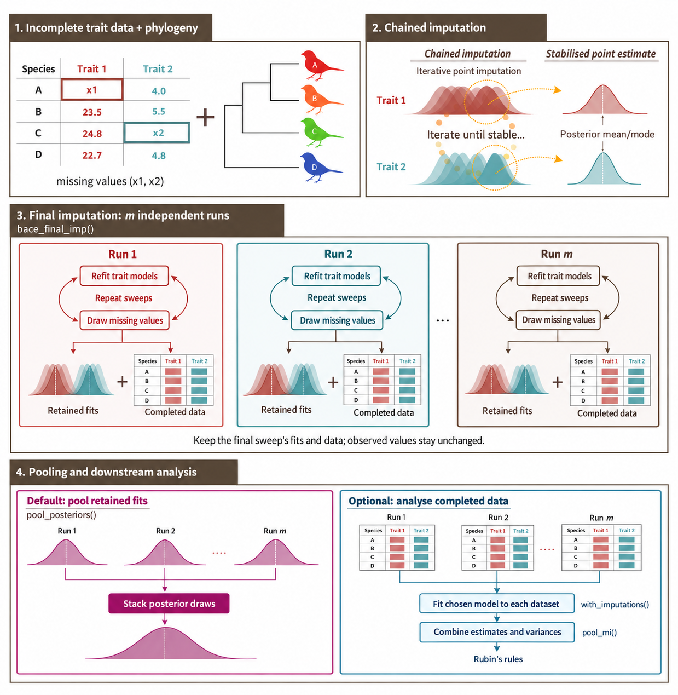

# Abstract

1. Missing trait data are pervasive in comparative datasets limiting the types of questions that can be tested and compromising the power of comparative analyses. Standard approaches, such as complete-case analyses and single imputation, can bias inference and underestimate uncertainty, particularly when missing data is non-random. While robust imputation methods exits, many existing software are restricted to imputing only continuous or count variables and lack the capacity to impute discrete / categorical traits (e.g., multinomial, ordered categorical), which are common trait types in comparative datasets. Such limitations have prevented the widespread use of imputation approaches in comparative biology.
2. We introduce **BACE**, an R package implementing **B**ayesian **A**ugmentation by **C**hained **E**quations for phylogenetic comparative data. *BACE* enables imputation with phylogeny-informed covariance that can account for both phylogenetic and non-phylogenetic species effects, along with mixed data types. *BACE* provides substantial flexibility in the imputation models fit, can decouple imputation models from analysis models, and propagates both parameter and imputation uncertainty in subsequent downstream analyses. 
3. Using simulations, we show that *BACE* provides little bias and nominal coverage in analyses with even a small number of species (~100) for diverse trait types, and those with small to moderate phylogenetic signal. We illustrate the use of *BACE* using two case studies: 1) imputing missing heat tolerance data across 5,203 species of amphibians from 524 species with data (89.9% missing data) and 2) . We provide a detailed tutorial on how it can be used and it is available for download on CRAN.
4. *BACE* provides a flexible, accessible workflow for imputing diverse trait types in comparative datasets. Although computationally demanding, it makes multiple imputation more widely applicable, supporting a broader range of evolutionary questions while accounting for missing-data uncertainty. 

# Introduction

Phylogenetic comparative methods (PCMs) provide a framework for understanding how traits evolve and covary across species [@felsenstein1985; @grafen1989; @pagel1994; @martins1997]. Expanding trait databases, increasingly comprehensive phylogenies, and greater access to environmental data are providing opportunities to investigate how evolutionary history and environmental conditions jointly shape variation and covariation among traits allowing a rich set of new evolutionary hypotheses to be tested [@halliwell2025; @blomberg2025]. However, missing trait data limit the questions that can be addressed, and excluding species with incomplete records can reduce sample sizes, statistical power and precision [@nakagawa2008; @little2024; @blomberg2025]. When the availability of trait data depends on species' characteristics, this exclusion can also bias estimates of trait relationships with significant consequences for inferences [@nakagawa2008; @gonzalezsuarez2012; @garamszegi2011]. For example, incomplete trait coverage has been shown to alter inferred relationships between mammalian traits and extinction risk [@gonzalezsuarez2012]. As such, there is a need for versatile and rigorous statistical approaches to deal with missing data in comparative biology.

Methods for handling missing data have a long history in statistics, and two broad approaches are commonly used [@noble2021; @blomberg2025; @littlerubin2002; @schafer2002; @rubin1987]. First, missing data can be accommodated during maximum-likelihood or Bayesian model fitting. For example, Bayesian data augmentation samples missing values alongside model parameters [@tanner1987]. Alternatively, multiple-imputation can be used to create, *m* completed datasets and each dataset analysed separately. Results are then pooled to account for within- and between-imputation uncertainty, using Rubin's rules for estimates and variances or combining posterior draws for Bayesian analyses [@rubin1987; @noble2021; @zhou2010]. These approaches are not mutually exclusive. Data augmentation can also generate the completed datasets used in multiple imputation. Imputations can be generated using a joint model for all variables or separate conditional models linked through chained equations. Chained equations cycle through models, drawing missing values for each variable using the latest values of the others. This approach, also called fully conditional specification, allows different models for continuous and categorical traits [@vanbuuren2011]. Standard multiple-imputation analyses assume data are missing at random (MAR), conditional on the variables included in the imputation models. As such, including traits associated with both the missing values and the probability of missingness helps make this assumption more plausible [@schafer2002; @gelmanhill2007, chap. 25; @noble2021]. In comparative biology, both phylogenetic prediction of missing trait values [@bruggeman2009; @goolsby2017] and multiple imputation [@pottier2025; @blomberg2025] have been used to deal with missing trait data. However, for widespread use in comparative biology, imputation models must accommodate diverse trait distributions and relationships which are often not possible with existing software.

While a broad array of statistical methods and packages exist to deal with missing data, many are not suited to the datasets typical of comparative biology (@tbl-software). A few packages can use the phylogeny in their imputation models (e.g., *Rphylopars*, *phylomice*, *TDIP*), but most cannot (e.g., *mice*, *miceadds*, *jomo*, *pan*; @tbl-software). Moreover, the phylogeny-aware packages generally return a single completed dataset or single predicted values rather than multiple imputations, and most impute only continuous traits. A notable exception is *TDIP* [@gendre2024], which combines phylogenetic and machine-learning methods in an ensemble and can impute discrete traits. However, it too returns single completed datasets, and it cannot handle multi-level data structures, count data, or ordered categorical traits (@tbl-software). As such, there is a need for a statistically robust and flexible imputation approach that can handle multi-level data structures and a diversity of trait types, while ensuring imputation uncertainty is correctly accounted for in any downstream analyses and interpretations.

Here, we introduce a new Bayesian imputation software package for comparative biology, named *BACE* (**B**ayesian **A**ugmentation by **C**hained **E**quations), which uses the versatile Bayesian software *MCMCglmm* [@hadfield2010jss] to conduct multiple imputation through chained equations. *BACE* provides substantial flexibility in the imputation / analysis models fit, as well as a simple user interface, which makes it easy to apply in practice. *BACE* also provides options to decouple imputation and analysis models. Given its Bayesian approach, imputation and analysis models can be fit jointly and a final analysis model allows for pooling of posterior distributions to account for within and across imputation uncertainty. Additionally, samples from the posterior predictive distribution can be used to generate a set of *m* complete datasets and these datasets can be used with any modelling approach and pooled using Rubin's rules. We describe how *BACE* works, test its robustness using simulations, and demonstrate how to apply it using two case studies.

<!-- authors: every cell of @tbl-software was verified against the package's own
reference documentation (current CRAN/GitHub version, October 2026); page-cited
evidence in .agents/software-comparison-evidence.md — intended as Supporting
Information at submission. -->

| Package | Phylo. | MI | Multi. | Cont. | Count | Bin. | Ord. | Nom. | Reference |
|:---|:---:|:---:|:---:|:---:|:---:|:---:|:---:|:---:|:---|
| **BACE** | **✓** | **✓** | (✓)^a^ | **✓** | **✓** | **✓** | **✓** | **✓** | this paper |
| Rphylopars | ✓ | ✗ | (✓) | ✓ | ✗ | ✗ | ✗ | ✗ | @goolsby2017 |
| phylomice^c^ | ✓ | ✓ | ✗ | ✓ | ✗ | ✗ | ✗ | ✗ | @drhlik2016 |
| TDIP^c^ | ✓ | ✗ | ✗ | ✓ | ✗ | ✓ | ✗ | ✓ | @gendre2024 |
| BHPMF^c^ | (✓)^b^ | ✗ | (✓) | ✓ | ✗ | ✗ | ✗ | ✗ | @schrodt2015 |
| mice | ✗ | ✓ | (✓) | ✓ | ✗ | ✓ | ✓ | ✓ | @vanbuuren2011 |
| miceadds | ✗ | ✓ | ✓ | ✓ | ✗ | ✓ | (✓)^d^ | ✗^d^ | @robitzsch2026 |
| micemd | ✗ | ✓ | ✓ | ✓ | ✓ | ✓ | (✓)^d^ | (✓)^d^ | @audigier2018 |
| pan | ✗ | ✓ | ✓ | ✓ | ✗ | ✗ | ✗ | ✗ | @schaferyucel2002 |
| jomo | ✗ | ✓ | ✓ | ✓ | ✗ | ✓ | (✓)^d^ | ✓ | @carpenter2013 |
| mitml | ✗ | ✓ | ✓ | ✓ | ✗ | ✓ | ✗ | ✓ | @grund2023 |
| hmi^c^ | ✗ | ✓ | ✓ | ✓ | ✓ | ✓ | ✓ | ✓ | @speidel2020 |
| mdmb | ✗ | ✓ | (✓) | ✓ | ✗ | ✓ | ✓ | ✗ | @robitzsch2024 |
| JointAI | ✗ | (✓)^e^ | ✓ | ✓ | ✓ | ✓ | ✓ | ✓ | @erler2021 |
| smcfcs | ✗ | ✓ | ✗ | ✓ | ✓ | ✓ | ✓ | ✓ | @bartlett2015 |
| missForest | ✗ | ✗ | ✗ | ✓ | ✗ | ✓ | ✗ | ✓ | @stekhoven2012 |

: R tools for imputing missing data, against the needs of phylogenetic comparative analysis. *Phylogeny* (Phylo.): a tree-derived covariance informs the imputation. *Proper multiple imputation* (MI): multiple imputed datasets (or an integrated Bayesian posterior) are produced, so downstream analyses reflect imputation uncertainty. *Multilevel* (Multi.): non-independence beyond the phylogeny (random effects / clustered rows). Remaining columns: an explicit imputation model for continuous (Cont.), count, binary (Bin.), ordinal (Ord., treated as ordered) and nominal (Nom., unordered multinomial) variables. ✓ = documented in the package's reference documentation (October 2026); (✓) = partial support; ✗ = not documented. {#tbl-software tbl-colwidths="[12,9,8,9,9,8,8,8,9,20]"}

::: {.table-notes}
^a^ Phylogenetic and species (replicated taxa) random effects; other grouping factors are not supported. ^b^ Taxonomic hierarchy (species/genus/family), not a tree with branch lengths. ^c^ Not on CRAN: *phylomice* and *TDIP* (GitHub only), *BHPMF* (archived 2017), *hmi* (removed 2022). ^d^ Ordinal/nominal support is limited: single-level methods only (*micemd*), predictive mean matching rather than an ordinal model (*miceadds*, whose multilevel methods also cannot impute nominal variables), or substantive-model-compatible outcome models only (*jomo*). ^e^ Imputation is integrated with the analysis model (fully Bayesian); imputed datasets can be exported.
:::

# The *BACE* R package: How it works?

*BACE* generates multiple completed datasets and pooled model posteriors from comparative data with missing trait values (@fig-bace-workflow). Users provide a data frame with species identifiers, a phylogeny with branch lengths, and model formulas specifying the predictors of each incomplete trait (@fig-bace-workflow, step 1). Continuous, count, binary, ordered categorical and unordered categorical traits can be included in the same dataset. Each trait's type is declared by how its column is stored in the data frame (numeric for continuous, integer for counts, factors — ordered or unordered — for categorical traits). *BACE* then selects the correct error distribution for the model automatically. For example, if the response variable is a count a Poisson error distribution (log link) is used whereas if the response is a two-level categorical variable it will use a Bernoulli error distribution (probit link). Because the phylogenetic tree is user-supplied, evolutionary models other than Brownian motion can also be accommodated. For example, any model expressible as a branch-length transformation — Pagel's κ and δ, early burst, or single-optimum Ornstein–Uhlenbeck on an ultrametric tree — is fitted by transforming the tree before imputation, with the transform parameter estimated externally [@hansen1997; @pagel1999; @blomberg2003]. 

*BACE* fits a separate phylogenetic mixed model for each incomplete trait with *MCMCglmm* [@hadfield2010jss].  Each model uses relationships among traits and shared evolutionary history to inform probable missing values. When species have repeated observations, a separate species effect can account for similarities not explained by the phylogeny [@hadfield2010; @nakagawa2012; @cinar2022]. Imputation has two phases. First, the models are fitted repeatedly, updating missing values with point estimates until these estimates stabilise (@fig-bace-workflow, step 2). In the final phase, `bace_final_imp()` starts *m* independent runs from the stabilised data (@fig-bace-workflow, step 3). Within each run, *BACE* repeatedly refits the trait models and updates missing values with posterior-predictive draws. Each model uses the latest imputations of the other traits, while its own missing responses remain unobserved during fitting. Each run retains the models from its final pass and a completed dataset containing the original observations and one draw for each missing value for both the response and predictors of the model.

The main function `bace()` runs this workflow and returns a single object containing the *m* completed datasets, pooled model posteriors, individual model fits and convergence diagnostics. Users can extract the completed datasets with `get_imputed_data()` and a pooled model for a particular trait with `get_pooled_model()`. Imputed values are returned on the scale of the supplied data. Model coefficients retain the fitted model's scale: Gaussian variables are standardised internally, count responses use a log link, and binary and ordinal responses use a probit link. When an imputation model's parameters are themselves of interest, its pooled posterior can be used directly. Alternatively, users can fit a different analysis model to each completed dataset and combine its results. Both routes carry imputation uncertainty into downstream analyses (@fig-bace-workflow, step 4).

```{r}
#| label: fig-bace-workflow
#| echo: false
#| out-width: "100%"
#| fig-cap: |
#|   **Overview of the BACE imputation workflow**. (1) Inputs are an incomplete
#|   trait dataset and a phylogeny covering the species. (2) Chained imputation:
#|   a separate phylogenetic mixed model is fitted for each incomplete trait,
#|   and missing values are updated with point estimates until they stabilise.
#|   (3) Final imputation: *m* independent runs start from the stabilised data.
#|   Each run cycles through the traits, refitting each model and replacing
#|   missing values with draws from it; a trait's own missing values are never
#|   treated as data during fitting. Each run keeps a completed dataset
#|   (observed values preserved) and the models from its final pass. (4) Pooling and downstream analysis: the default
#|   route pools posterior draws directly from these retained fits. Alternatively,
#|   a chosen analysis model is fitted to each completed dataset, and its
#|   coefficient estimates and variances are combined using Rubin's rules.


```

## Typical *BACE* workflow 

We demonstrate the typical user workflow in the code below, and @fig-function-map maps the package's relevant functions onto the workflow steps, including the alternative Rubin's-rules pathway. A detailed tutorial with simulated data, and demonstrating our case studies, is also provided in the package documentation (https://daniel1noble.github.io/BACE/). 

For users wishing to test out *BACE* or conduct simulations based on characteristics of their data, we also provide a simulation function `sim_bace()`. `sim_bace()` allows users to control the number of species, replicate observations per species, level of missing trait data, the distribution type of response and predictor variables, and the strength of the phylogenetic signal in each trait. Such simulations can help in planning analyses and identifying their power. 

```{r}
#| label: pipeline-pseudocode
#| echo: true
#| eval: false

# 1) Prepare data and tree (rows = taxa; factors declared; counts as integers)
# 2) Run the full workflow: chained imputation -> convergence check ->
#    n_final posterior-predictive imputations -> pooled posteriors
res <- bace(fixformula     = "y ~ x1 + x2",
            ran_phylo_form = "~ 1 | Species",
            phylo          = tree,
            data           = dat,
            runs           = 10, n_final = 50)

# 3) Diagnostics
plot(assess_convergence(res$initial_results))

# 4a) Bayesian route: pooled MCMCglmm posteriors
summary(get_pooled_model(res, "y"))

# 4b) Rubin's-rules route: any downstream model per imputed dataset
fits <- with_imputations(res, function(d) lm(y ~ x1 + x2, data = d))
pool_mi(fits)
```


*BACE* users with existing species trait datasets can apply the *BACE* workflow by specifying the imputation and/or analysis model(s) in `bace()`. Model formulas can be provided as a single formula or a list of formulas, one for each missing response variable, defined by the argument `fixformula`. Users then supply the name of species-level random effect as a formula (using argument `ran_phylo_form`). If users have repeated species, then the random effect structure can be adjusted by setting the `species = TRUE` argument, which will add an additional non-phylogenetic random effect for species [@cinar2022; @hadfield2010]. If provided an analysis model with missing predictors, *BACE* will create equations for all variables with missing trait data automatically.

```{=latex}
\begin{landscape}
```

```{=openxml}
<w:p><w:pPr><w:sectPr><w:footerReference w:type="default" r:id="rId9"/><w:pgSz w:w="12240" w:h="15840"/><w:pgMar w:top="851" w:right="851" w:bottom="851" w:left="851" w:header="720" w:footer="720" w:gutter="0"/><w:lnNumType w:countBy="1" w:restart="continuous"/></w:sectPr></w:pPr></w:p>
```

![**Map of the core user-facing *BACE* functions**. Solid arrows show the main workflow from raw comparative data through chained imputation (`bace_imp()`), convergence assessment of the chained loop (`assess_convergence()`), posterior-predictive final imputations (`bace_final_imp()`) and posterior pooling (`pool_posteriors()`), with accessors (`get_pooled_model()`, `get_imputed_data()`) reading the finished object. The shaded band marks the steps run end-to-end by `bace()`, which automatically retries the chained phase on non-convergence. The lower-right branch is the alternative Rubin's-rules pathway: `with_imputations()` fits any downstream analysis model to each completed dataset and `pool_mi()` combines the estimates. Dashed boxes mark optional routes: simulating benchmark data (`sim_bace()`), pre-flight phylogenetic-signal screening (`phylo_signal_summary()`), per-model MCMC and prior control, and convergence visualisations.](../vignettes/figs/bace_function_map.png){#fig-function-map width=9in}

```{=openxml}
<w:p><w:pPr><w:sectPr><w:footerReference w:type="default" r:id="rId9"/><w:pgSz w:w="15840" w:h="12240" w:orient="landscape"/><w:pgMar w:top="851" w:right="851" w:bottom="851" w:left="851" w:header="720" w:footer="720" w:gutter="0"/><w:lnNumType w:countBy="1" w:restart="continuous"/></w:sectPr></w:pPr></w:p>
```

```{=latex}
\end{landscape}
```

*BACE* provides convergence diagnostics which help to identify possible issues during model fitting that need to be checked prior to inference. For example, within-chain Markov chain Monte Carlo (MCMC) convergence of each parameter in the per-variable model as well as convergence of the chained-equations loop (the imputed-data sequence) are provided as output when `bace()` is run or can be investigated after the imputation workflow is complete. `assess_convergence()` and `plot_*_convergence()` are two functions that provide users with various diagnostics on the change in imputed values as chained equations proceed. MCMC chains of any final model and parameter can be investigated using standard R functions (e.g., trace plots via `plot()`, effective sample sizes via `coda::effectiveSize()` and autocorrelation via `coda::autocorr.diag()`; @plummer2006). Convergence information is important to identify when different priors or a different number of MCMC iterations are needed. In `bace()`, `runs` controls the initial chained-imputation passes, and `n_final` sets the number of completed datasets (default 50). Within each model, `nitt`, `burnin` and `thin` control the total MCMC iterations, initial iterations discarded and interval between retained samples, respectively. For `nitt`, `burnin` and `thin`, users can supply one value for all models or a list with one value per equation, in formula order, to tune sampling separately for each response. 

*BACE* provides two routes for combining results across imputations. The default, `pool_posteriors()`, stacks posterior draws from the *MCMCglmm* fits retained in the final pass of each independent run, giving a pooled posterior for each trait model [@zhou2010]. The returned models contain pooled draws for regression coefficients and variance components, from which users can obtain posterior means and credible intervals. Alternatively, `with_imputations()` fits a user-specified analysis model to each completed dataset and `pool_mi()` combines its coefficient estimates and variances using Rubin's rules [@rubin1987]. The workflow follows a similar syntax to the *mice* package [@vanbuuren2011]. `pool_mi()` returns a table with one row per coefficient, including the pooled estimate, standard error, confidence interval, test statistic, degrees of freedom and *p*-value. It also reports the **fraction of missing information** (`fmi`), which estimates how much information about each coefficient is lost because of missing data, and the **relative increase in variance** (`riv`), which measures the extra variance from imputation uncertainty relative to the average within-imputation variance of that coefficient [@rubin1987]. Larger values indicate that missing data have a greater effect on the precision of that coefficient.

# Evaluating the performance of BACE with simulations

## Simulation design
*(Structure only. Sources: `dev/12_recovery_simulation.R`, `dev/13_response_type_simulation.R`, `dev/simulation_results/SIMULATION_REPORT.qmd`; design details in `.agents/simulation-report.html`.)*
- Study A: parameter recovery (gaussian slope) under MCAR/MAR; oracle and complete-case comparators.
- Study B: five response types x MCAR/MAR; per-type accuracy/coverage metrics and their finite-draw/metric ceilings (`cover95_t`, prob-based sets, Bayes ceiling for categorical).


## Simulation results
We show using simulations that *BACE* recovers missing trait values with a high degree of accuracy.  Across 18 different scenarios that vary in sample size (n = 100, 300, 1000 species), phylogenetic signal (Pagel’s λ = 0.3, 0.7, 1) and trait correlation (ρ = 0, 0.5), we show *BACE* recovers model parameters with little bias and nominal coverage. *BACE* outperformed other comparable frequentist approaches.  


## Parameter recovery and inferential calibration (Study A)
<!-- TODO(authors): numbers in .agents/project-state.md "Re-validation" -
     MAR slope coverage 0.950, MCAR 0.975; complete-case MAR mean bias
     -0.259 vs BACE +0.011; CI width ratio. Figure candidate:
     dev/simulation_results/ figures. -->
## Imputation accuracy across response types (Study B)
<!-- TODO(authors): per-type table - recovery, coverage vs ceiling; pre/post
     bug-fix contrast if wanted (archive_2026-07_prebugfix). Numbers in
     .agents/project-state.md table. -->

```{r}
#| label: tbl-studyb
#| eval: false
# TODO(analysis): build the Study B summary table from
# dev/simulation_results/response_type_per_rep.csv (per-rep metrics).
```


# Worked examples
We now turn to two case studies to demonstrate application of *BACE*. The first case study involves data from @pottier2025. @pottier2025 imputed heat tolerance (continuous trait) under standardised conditions for 5,203 amphibian species of which only 524 species (10.1%) have trait data. The second case study, uses BIRDBASE and AVONET to impute social (categocial and continuous data), for 10,563 bird species. 

# Discussion
*(Structure only.)*
- What BACE adds relative to existing MI and phylogenetic-prediction tools.
- Honest limitations <!-- TODO(authors): from .agents/project-state.md -
     poisson MAR t-interval 0.916 (log-link extrapolation; metric ceiling
     ~0.93-0.94 for skewed predictives), categorical sets slightly
     conservative (0.984), MNAR out of scope, runtime scaling. -->
- Practical guidance (pre-flight signal screening; when BACE is the wrong tool).


# Acknowledgements
*(To write.)*

# Author contributions

Author contributions are reported using the CRediT taxonomy. **DWAN:** conceptualization, methodology, software, formal analysis, validation, visualization, writing — original draft, writing — review and editing, project administration. **SMD:** conceptualization, methodology, software, writing — review and editing. **AM:** software, validation, investigation (AVONET case study and tutorial), visualization, writing — review and editing. **PP:** data curation, investigation (amphibian heat-tolerance case study), writing — review and editing. **SN:** conceptualization, methodology, formal analysis, validation (independent simulation study), writing — review and editing. All authors approved the final version.

<!-- TODO(authors): draft roles inferred from the project record - each author
     please confirm/amend, especially SMD (least visible in the repo history)
     and whether Funding acquisition should be assigned to anyone. -->

# Data and code availability
*BACE* (version 0.1.0) is free and open-source software released under the GPL (≥ 3). The source code and development version are available on GitHub (<https://github.com/daniel1noble/BACE>), where issues and feature requests can also be reported. A full tutorial — covering installation, when *BACE* is appropriate relative to other imputation tools, the complete workflow, and interpretation of pooled output and diagnostics — is available at <https://daniel1noble.github.io/BACE/>. A CRAN submission is in preparation; once accepted, the package will be installable directly via `install.packages("BACE")` (<https://CRAN.R-project.org/package=BACE>). Code reproducing all simulations reported here is included in the repository (`dev/`).

# References

::: {#refs}
:::
