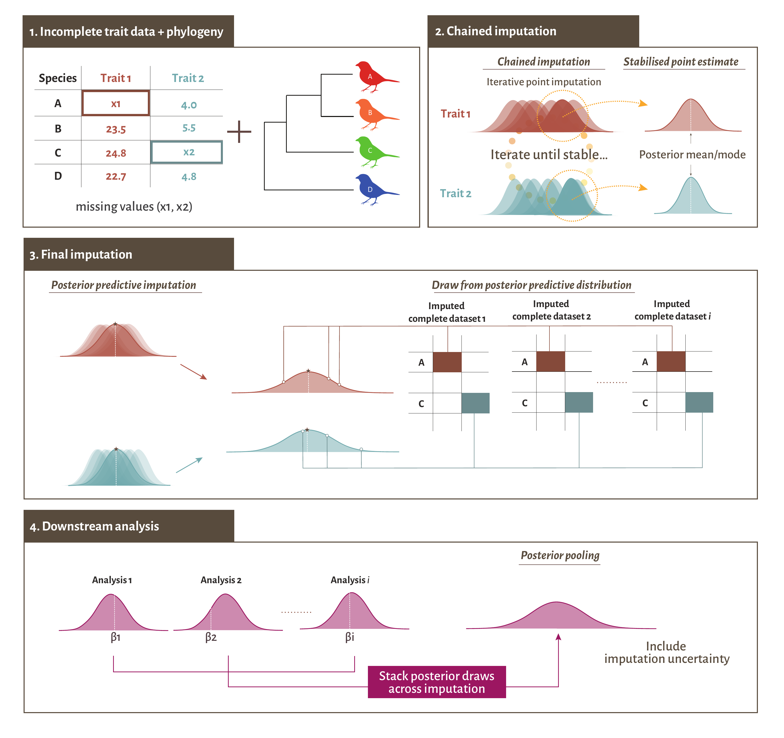

# Abstract

1. Missing trait data are pervasive in comparative datasets limiting the types of questions that can be tested and compromising the power of comparative analyses. Standard approaches, such as complete-case analyses and single imputation, can bias inference and underestimate uncertainty, particularly when missing data is non-random. While robust imputation methods exits, many existing software are restricted to imputing only continuous or count variables and lack the capacity to impute discrete / categorical traits (e.g., multinomial, ordered categorical), which are common trait types in comparative datasets. Such limitations have prevented the widespread use of imputation approaches in comparative biology.
2. We introduce *BACE*, an R package implementing Bayesian Augmentation by Chained Equations for phylogenetic comparative data. *BACE* enables imputation with phylogeny-informed covariance that can account for both phylogenetic and non-phylogenetic species effects, along with mixed data types, in a fully Bayesian pipeline. *BACE* provides substantial flexibility in the imputation models fit, can decouple imputation models from analysis models, and propagates both parameter and imputation uncertainty in subsequent downstream analyses. 
3. We show using simulations that *BACE* recovers missing trait values with a high degree of accuracy.  Across 18 different scenarios that vary in sample size (n = 100, 300, 1000 species), phylogenetic signal (Pagel’s λ = 0.3, 0.7, 1) and trait correlation (ρ = 0, 0.5), we show *BACE* recovers model parameters with little bias and nominal coverage. *BACE* outperformed other comparable frequentist approaches. We illustrate *BACE* using two case studies. The first imputes amphibian heat tolerance (continuous) under standardised conditions across 5,203 species using 2,661 experimental estimates from 524 species; 89.9% of species lack experimental measurements. The second uses AVONET data for 10,563 bird species to impute migratory behaviour (ordered categorical) and hand-wing index (continuous), addressing 17 naturally missing migration records (0.16%) and testing imputation after withholding approximately 20% of observed values for each trait. 
4. 

# Introduction

Phylogenetic comparative methods (PCMs) provide a framework for understanding how traits evolve and covary across species while accounting for their shared evolutionary history [@felsenstein1985; @grafen1989; @pagel1994; @martins1997]. Expanding trait databases, increasingly comprehensive phylogenies, and greater access to environmental data provide opportunities to investigate how evolutionary history and environmental conditions shape variation and covariation among traits allowing one to test a rich set of evolutionary hypotheses [@halliwell2025; @blomberg2025]. However, missing trait data limit the questions that can be addressed, and excluding species with incomplete records can reduce sample sizes, statistical power and precision [@nakagawa2008; @little2024; @blomberg2025]. When the availability of trait data depends on species' characteristics, this exclusion can also bias estimates of trait relationships [@nakagawa2008; @gonzalezsuarez2012]. Empirical studies illustrate the consequences of missing data for answering questions in comparative biology. For example, incomplete trait coverage alters inferred relationships between mammalian traits and extinction risk [@gonzalezsuarez2012], while missing values in comparative datasets tend to be distributed nonrandomly across species — in relation to characteristics such as rarity and body size — which can bias parameter estimates and model selection when using complete-case analyses [@garamszegi2011].

Methods for handling missing data have a long history in statistics [@schafer2002]. Approaches developed for comparative datasets include phylogenetic prediction of missing trait values [@bruggeman2009; @goolsby2017], as well as multiple-imputation procedures that account for phylogenetic and species-sampling uncertainty [@nakagawa2018; @blomberg2025]. Missing values can be accommodated within model fitting, for example through Bayesian data augmentation, which samples missing values alongside model parameters [@tanner1987]. Alternatively, missing data can be handled in a multiple-imputation workflow, where *m* complete datasets are generated and analysed separately. Parameter estimates and their variances are then combined, commonly using Rubin's rules, to account for both within- and between-imputation uncertainty [@rubin1987; @noble2021]. Data augmentation can also be used to generate the completed datasets for multiple imputation [@schafer2002]. Multiple imputations can be generated using a joint model for all variables or separate conditional models linked through chained equations. Chained equations cycle through these models, drawing missing values for each incomplete variable using the latest values of the others. This approach, also called fully conditional specification, allows different models for continuous and categorical variables [@vanbuuren2011]. Importantly, multiple imputation — like most missing-data methods — assumes data are missing at random (MAR), and the plausibility of this assumption rests on imputation models that include the traits covarying with both the missing values and the probability of missingness [@schafer2002; @noble2021]. Because these relationships, and the types of the traits involved, differ from trait to trait, imputation requires substantial flexibility in the models fit to each one.

While a broad array of statistical methods and packages exist to deal with missing data, many are not suited to the datasets typical of comparative biology (@tbl-software). A few packages can use the phylogeny in their imputation models (e.g., *Rphylopars*, *phylomice*, *TDIP*), but most cannot (e.g., *mice*, *miceadds*, *jomo*, *pan*; @tbl-software). Moreover, the phylogeny-aware packages generally return a single completed dataset or single predicted values rather than multiple imputations, and most impute only continuous traits. A notable exception is *TDIP* [@gendre2024], which combines phylogenetic and machine-learning methods in an ensemble and can impute discrete traits. However, it too returns single completed datasets, and it cannot handle multi-level data structures, count data, or ordered categorical traits (@tbl-software). As such, there is a need for a statistically robust and flexible imputation approach that can handle multi-level data structures and a diversity of trait types.

Here, we introduce a new Bayesian imputation software package for comparative biology, named *BACE* (**B**ayesian **A**ugmentation by **C**hained **E**quations), which uses the versatile Bayesian software *MCMCglmm* [@hadfield2010] to conduct multiple imputation through chained equations. *BACE* provides substantial flexibility in the imputation / analysis models fit, as well as a simple user interface. *BACE* also provides options to decouple imputation and analysis models. Given its Bayesian approach, imputation and analysis models can be fit jointly and a final analysis model allows for pooling of posterior distributions to account for within and across imputation uncertainty. Additionally, samples from the posterior predictive distribution can be used to generate a set of *m* complete datasets and these datasets can be used with any model and pooled using Rubin's rules. We describe how *BACE* works, test its robustness using simulations, and demonstrate how to apply it in two case studies: imputing heat tolerance (continuous) under standardised conditions for 5,203 amphibian species of which only 524 (10.1%) have trait data, and jointly imputing migratory behaviour (ordered categorical) and hand-wing index (continuous) for 10,563 bird species in AVONET, validating the imputations by withholding approximately 20% of the observed values of each trait.  

```{r}
#| label: fig-bace-workflow
#| echo: false
#| out-width: "100%"
#| fig-cap: |
#|   **Overview of the BACE imputation pipeline**. (1) The inputs are a
#|   comparative dataset with missing trait values and a phylogeny covering the
#|   species. (2) Chained imputation: each variable with missing data gets its own
#|   phylogenetic mixed model, and the models are cycled iteratively — each
#|   iteration replacing the missing values with point estimates (posterior
#|   mean/mode) — until the imputed values stabilise. (3) Final imputation: starting
#|   from the converged dataset, each missing value is drawn from its posterior
#|   predictive distribution, independently and repeatedly, yielding multiple
#|   completed datasets that together capture imputation uncertainty. (4) Posterior distributions pooled: If the analysis model is included in the imputation set then inferences can be done on the pooled posterior which pools uncertainty within a model fit to the compete data as well as betwene imputation uncertainty; (5) Further downstream
#|   analysis: alternatively, a different analysis model can be fit to every completed dataset and the
#|   posterior draws stacked (pooled) across imputations (if Bayesian) or parameter estimates and uncertainty pooled using Rubin's rules. In this way, the final posterior
#|   reflects both parameter and imputation uncertainty.


```


<!-- authors: every cell of @tbl-software was verified against the package's own
reference documentation (current CRAN/GitHub version, October 2026); page-cited
evidence in .agents/software-comparison-evidence.md — intended as Supporting
Information at submission. -->

| Package | Phylo. | MI | Multi. | Cont. | Count | Bin. | Ord. | Nom. | Reference |
|:---|:---:|:---:|:---:|:---:|:---:|:---:|:---:|:---:|:---|
| **BACE** | **✓** | **✓** | (✓)^a^ | **✓** | **✓** | **✓** | **✓** | **✓** | this paper |
| Rphylopars | ✓ | ✗ | (✓) | ✓ | ✗ | ✗ | ✗ | ✗ | @goolsby2017 |
| phylomice^c^ | ✓ | ✓ | ✗ | ✓ | ✗ | ✗ | ✗ | ✗ | @drhlik2016 |
| TDIP^c^ | ✓ | ✗ | ✗ | ✓ | ✗ | ✓ | ✗ | ✓ | @gendre2024 |
| BHPMF^c^ | (✓)^b^ | ✗ | (✓) | ✓ | ✗ | ✗ | ✗ | ✗ | @schrodt2015 |
| mice | ✗ | ✓ | (✓) | ✓ | ✗ | ✓ | ✓ | ✓ | @vanbuuren2011 |
| miceadds | ✗ | ✓ | ✓ | ✓ | ✗ | ✓ | (✓)^d^ | ✗^d^ | @robitzsch2026 |
| micemd | ✗ | ✓ | ✓ | ✓ | ✓ | ✓ | (✓)^d^ | (✓)^d^ | @audigier2018 |
| pan | ✗ | ✓ | ✓ | ✓ | ✗ | ✗ | ✗ | ✗ | @schaferyucel2002 |
| jomo | ✗ | ✓ | ✓ | ✓ | ✗ | ✓ | (✓)^d^ | ✓ | @carpenter2013 |
| mitml | ✗ | ✓ | ✓ | ✓ | ✗ | ✓ | ✗ | ✓ | @grund2023 |
| hmi^c^ | ✗ | ✓ | ✓ | ✓ | ✓ | ✓ | ✓ | ✓ | @speidel2020 |
| mdmb | ✗ | ✓ | (✓) | ✓ | ✗ | ✓ | ✓ | ✗ | @robitzsch2024 |
| JointAI | ✗ | (✓)^e^ | ✓ | ✓ | ✓ | ✓ | ✓ | ✓ | @erler2021 |
| smcfcs | ✗ | ✓ | ✗ | ✓ | ✓ | ✓ | ✓ | ✓ | @bartlett2015 |
| missForest | ✗ | ✗ | ✗ | ✓ | ✗ | ✓ | ✗ | ✓ | @stekhoven2012 |

: R tools for imputing missing data, against the needs of phylogenetic comparative analysis. *Phylogeny* (Phylo.): a tree-derived covariance informs the imputation. *Proper multiple imputation* (MI): multiple imputed datasets (or an integrated Bayesian posterior) are produced, so downstream analyses reflect imputation uncertainty. *Multilevel* (Multi.): non-independence beyond the phylogeny (random effects / clustered rows). Remaining columns: an explicit imputation model for continuous (Cont.), count, binary (Bin.), ordinal (Ord., treated as ordered) and nominal (Nom., unordered multinomial) variables. ✓ = documented in the package's reference documentation (October 2026); (✓) = partial support; ✗ = not documented. {#tbl-software tbl-colwidths="[13,8,8,9,8,8,8,8,9,21]"}

::: {.table-notes}
^a^ Phylogenetic and species (replicated taxa) random effects; other grouping factors are not supported. ^b^ Taxonomic hierarchy (species/genus/family), not a tree with branch lengths. ^c^ Not on CRAN: *phylomice* and *TDIP* (GitHub only), *BHPMF* (archived 2017), *hmi* (removed 2022). ^d^ Ordinal/nominal support is limited: single-level methods only (*micemd*), predictive mean matching rather than an ordinal model (*miceadds*, whose multilevel methods also cannot impute nominal variables), or substantive-model-compatible outcome models only (*jomo*). ^e^ Imputation is integrated with the analysis model (fully Bayesian); imputed datasets can be exported.
:::

# Overview of the BACE framework
*BACE* provides options for direct imputation and parameter recovery of a given model with missing trait data or imputed trait data which can be pooled in downstream analyses such that the imputation and analysis models are different.

## Concept: Bayesian augmentation by chained equations
- Describe the iterative cycle (variable-by-variable conditional models).
- Emphasise “augmentation”: draw missing values from the posterior predictive distribution each cycle.

## Phylogenetic information in the imputation model
- How the tree enters (e.g., covariance among species; phylogenetic random effect).
- How this interacts with species-level random effects and other grouping structures.

## Supported data types and models (v1 scope)
*(Explicitly list what is supported in BACE v1 to avoid overclaiming.)*
- Continuous
- Binary
- Count
- Ordered categorical
- Unordered categorical (multinomial) *(if/when supported)*
- Missingness patterns handled (MCAR/MAR; sensitivity options if present)

> **Design choice box (optional):** When to use a joint-model vs chained equations; why BACE chooses chained equations.

# The BACE R package

## Inputs, outputs, and core workflow
- Inputs: data frame, species ID, phylogeny, optional predictors, grouping factors, priors, M (number of imputations / posterior draws).
- Outputs: imputed datasets (long/wide), posterior summaries, diagnostics, helper functions for pooling and downstream analysis.

## Typical user pipeline (pseudo-code)
```{r}
#| label: pipeline-pseudocode
#| echo: true
#| eval: false

# 1) Prepare data and tree (rows = taxa; factors declared; counts as integers)
# 2) Run the full workflow: chained imputation -> convergence check ->
#    n_final posterior-predictive imputations -> pooled posteriors
res <- bace(fixformula     = "y ~ x1 + x2",
            ran_phylo_form = "~ 1 | Species",
            phylo          = tree,
            data           = dat,
            runs           = 10, n_final = 50)

# 3) Diagnostics
plot(assess_convergence(res$initial_results))

# 4a) Bayesian route: pooled MCMCglmm posteriors
summary(get_pooled_model(res, "y"))

# 4b) Rubin's-rules route: any downstream model per imputed dataset
fits <- with_imputations(res, function(d) lm(y ~ x1 + x2, data = d))
pool_mi(fits)
```

## Convergence diagnostics
*(Structure only — content to write. See tutorial "Two kinds of convergence".)*
- Within-chain MCMC convergence of each per-variable model vs convergence of the chained-equations loop (the imputed-data sequence).
- `assess_convergence()` criteria (%-change + trend + ACF) and the `plot_*_convergence()` family.

## Pooling pathways: stacked posteriors and Rubin's rules
*(Structure only. Sources: `.agents/plans/pool_mi_rubin.md`; tutorial "Interpreting the pooled output"; Zhou & Reiter 2010; BDA3 Ch. 18.)*
- `pool_posteriors()`: stacking per-imputation chains approximates the marginal posterior; not Rubin's rules; O(1/M) difference at small M.
- `with_imputations()` + `pool_mi()`: model-agnostic Rubin's rules (Barnard–Rubin df, fmi/riv); matches `mice::pool` to machine precision.
- When to use which (variance components never via Rubin).

{#fig-function-map}

# Performance evaluation

## Simulation design
*(Structure only. Sources: `dev/12_recovery_simulation.R`, `dev/13_response_type_simulation.R`, `dev/simulation_results/SIMULATION_REPORT.qmd`; design details in `.agents/simulation-report.html`.)*
- Study A: parameter recovery (gaussian slope) under MCAR/MAR; oracle and complete-case comparators.
- Study B: five response types x MCAR/MAR; per-type accuracy/coverage metrics and their finite-draw/metric ceilings (`cover95_t`, prob-based sets, Bayes ceiling for categorical).

## Parameter recovery and inferential calibration (Study A)
<!-- TODO(authors): numbers in .agents/project-state.md "Re-validation" -
     MAR slope coverage 0.950, MCAR 0.975; complete-case MAR mean bias
     -0.259 vs BACE +0.011; CI width ratio. Figure candidate:
     dev/simulation_results/ figures. -->

## Imputation accuracy across response types (Study B)
<!-- TODO(authors): per-type table - recovery, coverage vs ceiling; pre/post
     bug-fix contrast if wanted (archive_2026-07_prebugfix). Numbers in
     .agents/project-state.md table. -->

```{r}
#| label: tbl-studyb
#| eval: false
# TODO(analysis): build the Study B summary table from
# dev/simulation_results/response_type_per_rep.csv (per-rep metrics).
```

## Benchmark against existing tools
*(Pending Track B3: missForest, Rphylopars, mice as feasible. Note: pigauto is a companion package, not a competitor — see `.agents/pigauto.md` for positioning.)*

# Worked example
*(Pending Track B4: AVONET at production MCMC settings; 300-species subset exists from the April benchmark.)*

# Discussion
*(Structure only.)*
- What BACE adds relative to existing MI and phylogenetic-prediction tools.
- Honest limitations <!-- TODO(authors): from .agents/project-state.md -
     poisson MAR t-interval 0.916 (log-link extrapolation; metric ceiling
     ~0.93-0.94 for skewed predictives), categorical sets slightly
     conservative (0.984), MNAR out of scope, runtime scaling. -->
- Practical guidance (pre-flight signal screening; when BACE is the wrong tool).
- Relationship to pigauto (division of labour).

# Availability and reproducibility
*(Structure only.)*
- Package: GitHub (daniel1noble/BACE), tutorial site, CRAN (pending).
- Simulation reproduction: `dev/12`, `dev/13`, `dev/14`, `SIMULATION_REPORT.qmd` (commands in `.agents/README.md`).

# Acknowledgements
*(To write.)*

# Author contributions
*(To write — CRediT.)*

# Data and code availability
*(To write.)*

# References

::: {#refs}
:::
